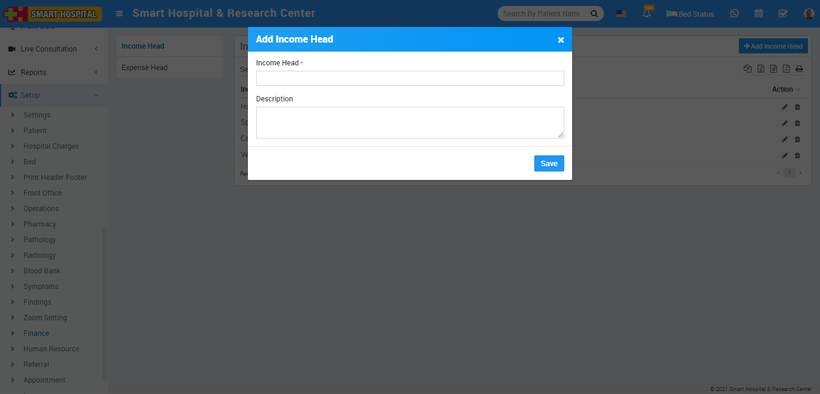
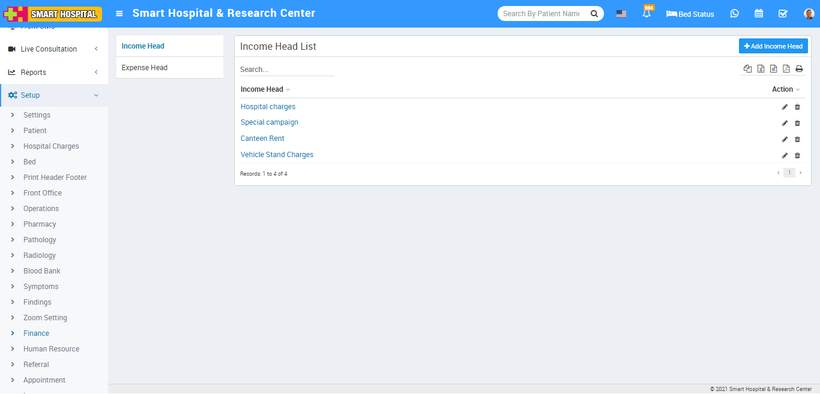
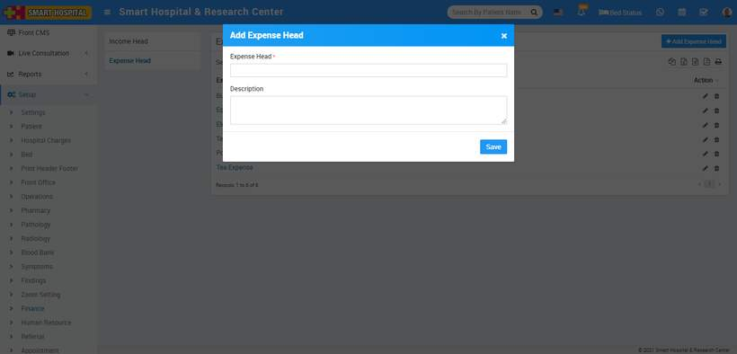
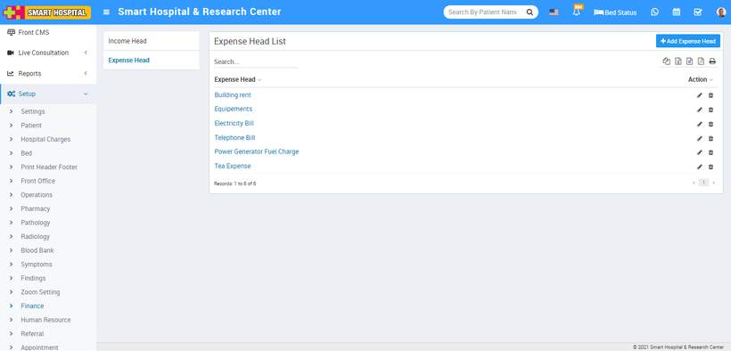

# Finance

_Sun, 31 Oct, 2021_ · [Setup & Configuration (22)](https://smart-hospital.in/category/setup-configuration) · vendor article: https://smart-hospital.in/article/finance

### Finance

Sun, 31 Oct, 2021

[Articles](https://smart-hospital.in/articles)[Setup & Configuration](https://smart-hospital.in/category/setup-configuration)

---

To setup Finance go to **Setup > Finance**.  
  

### **Income Head**

To add Income Head click on **+ Add Income Head** button now enter **Income Head, Description** and click on **Save** button.  
  

You can check added Income Head record at **Income Head List** page.  
  

To edit Income Head click on edit and to delete Income Head click on delete icon present at **Action** column.

### **Expense Head**

To add Expense Head click on **+ Add Expense Head** button now enter Expense Head, Description and click on **Save** button.  
  

You can check added Expense Head record at **Expense Head List** page.  
  

To edit Expense Head click on edit and to delete Expense Head click on delete icon present at **Action** column.
