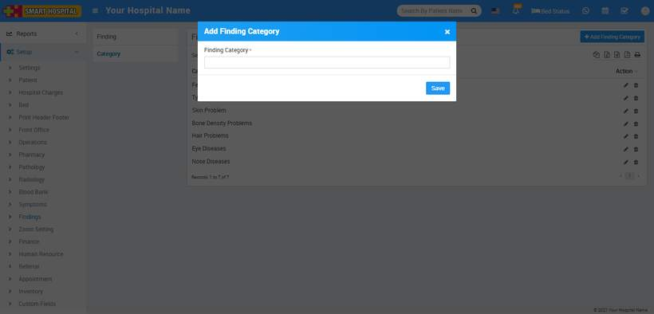
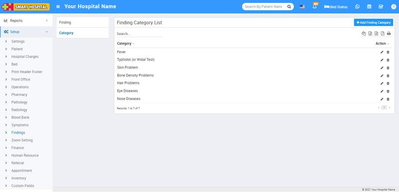
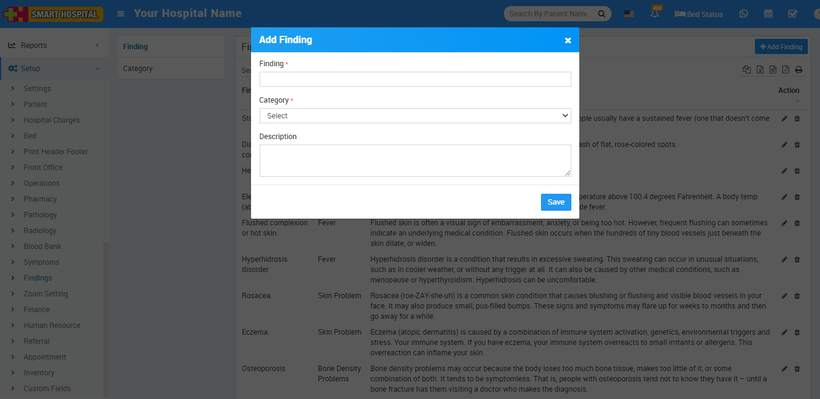
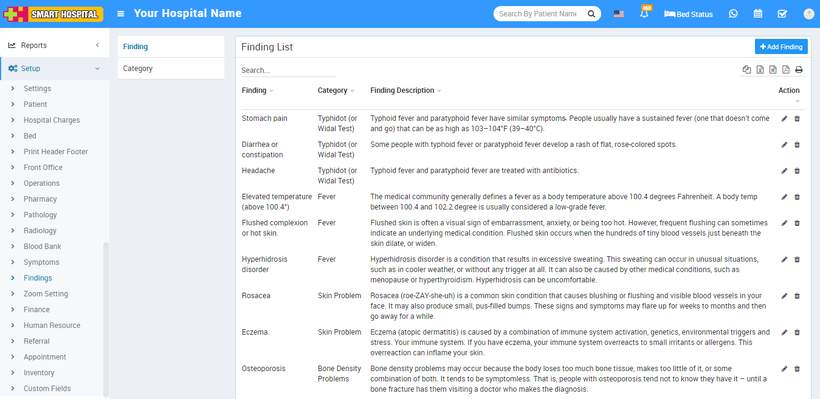

# Findings

_Thu, 28 Oct, 2021_ · [Setup & Configuration (22)](https://smart-hospital.in/category/setup-configuration) · vendor article: https://smart-hospital.in/article/findings

### Findings

Thu, 28 Oct, 2021

[Articles](https://smart-hospital.in/articles)[Setup & Configuration](https://smart-hospital.in/category/setup-configuration)

---

To add Finding at Add Prescription, first go to **Setup > Findings** here you will get two options as **Finding** and **Category**. Here first we will create **Finding Category** and then will create **Finding**.  
  

### **Finding Category**

To add Findings Category click on **+ Add Finding Category** button now enter **Finding Category** and click on **Save** button.  
  

You can check added Category record at **Category List** page.  
  

To edit Category click on edit and to delete Category click on delete icon present at **Action** column.

---

### **Finding**

Now to add Findings click on Finding then click on **+ Add Finding** button, here enter **Finding (symptoms in patient)**, select **Category**, add **Description** and then click on **Save** button.  
  
  
  
You can view this added record in the Finding List on the right side of the page.  
  
  
  
To edit Findings click on edit and to delete Findings click on delete icon present at **Action** column.
