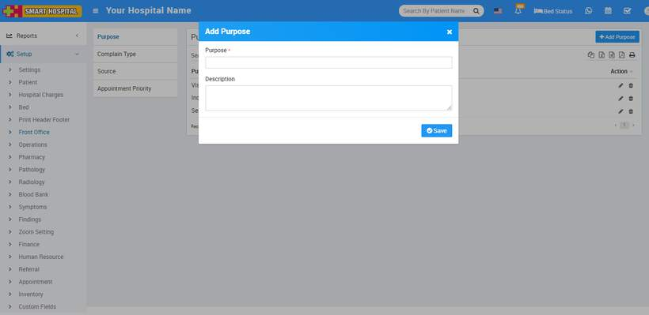
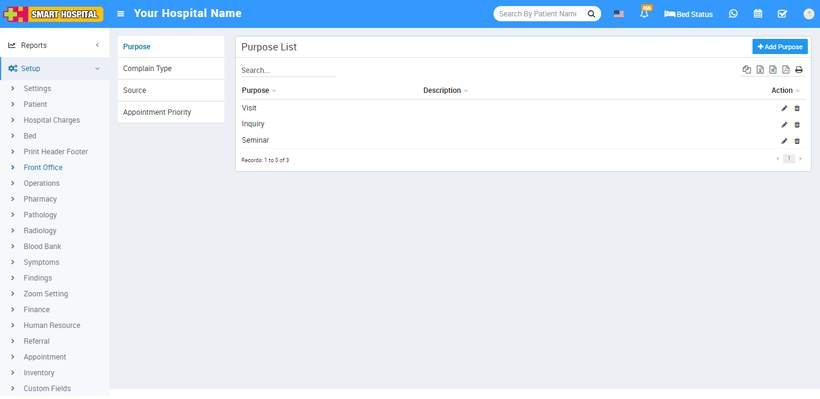
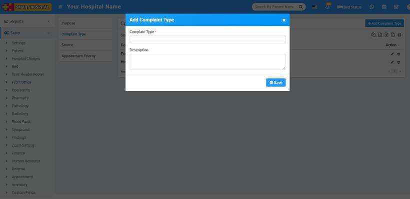
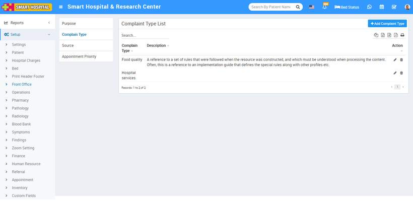
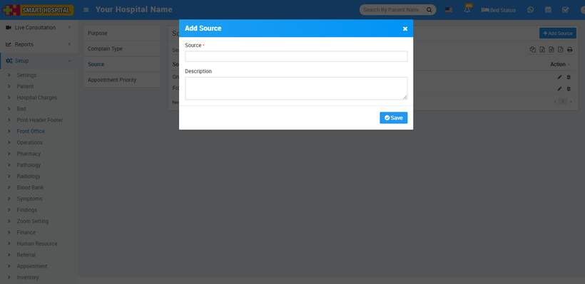
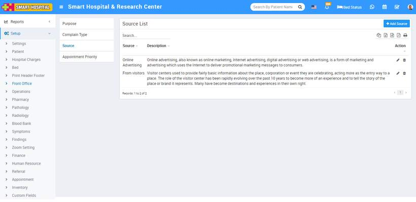
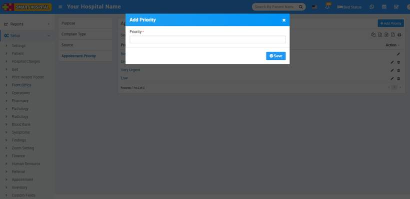
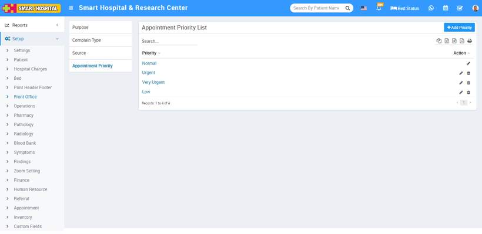

# Front Office

_Sun, 31 Oct, 2021_ · [Setup & Configuration (22)](https://smart-hospital.in/category/setup-configuration) · vendor article: https://smart-hospital.in/article/front-office

### Front Office

Sun, 31 Oct, 2021

[Articles](https://smart-hospital.in/articles)[Setup & Configuration](https://smart-hospital.in/category/setup-configuration)

---

To setup Front Office go to **Setup > Front Office.**

### **Visitor Purpose**

To add Visitor Purpose click on **+ Add Purpose** button now enter **Purpose and Description** and click on **Save** button.  
  
  

You can check added Purpose record at **Purpose List** page.  
  

To edit Purpose click on edit and to delete Purpose click on delete icon present at **Action** column.

---

### **Complain Type**

To add Complain Type click on **+ Add Complain Type** button now enter **Complain Type** and **Description** and click on **Save** button.  
  
  
  
  

You can check added Complain Type record at **Complaint Type List** page.  
  

To edit Complain Type click on edit and to delete Complain Type click on delete icon present at **Action** column.

---

### **Complain Source**

To add Complain Source click on **+ Add Source** button now enter **Source** and **Description** and click on **Save** button.  
  
  

You can check added Source record at **Source List** page.  
  

To edit Source click on edit and to delete Source click on delete icon present at **Action** column.

  

---

### **Priority**

To add Priority click on **+ Add Appointment Priority** button now enter Priority and click on **Save** button.  
  

You can check added Appointment Priority record at **Appointment Priority List** page.  
  
  

To edit Appointment Priority click on edit and to delete Appointment Priority click on delete icon present at **Action** column.
