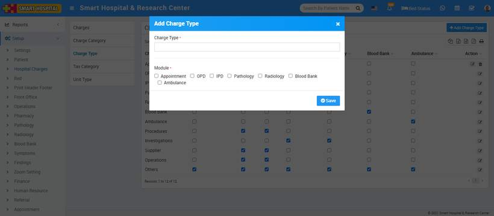
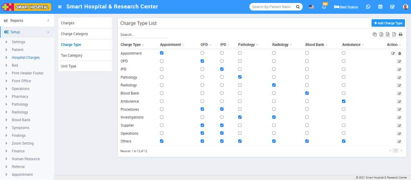
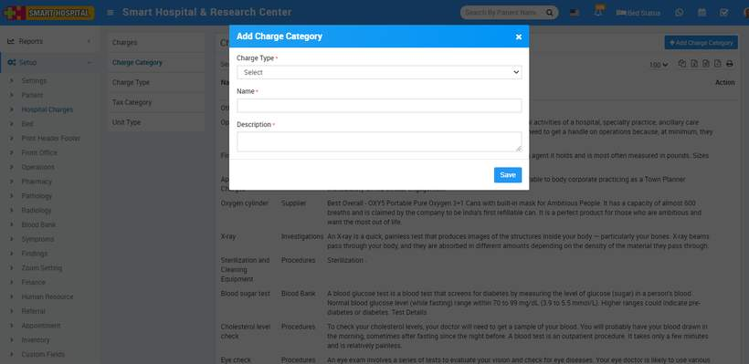
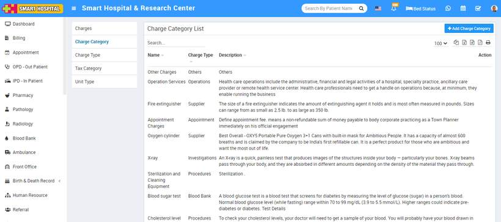
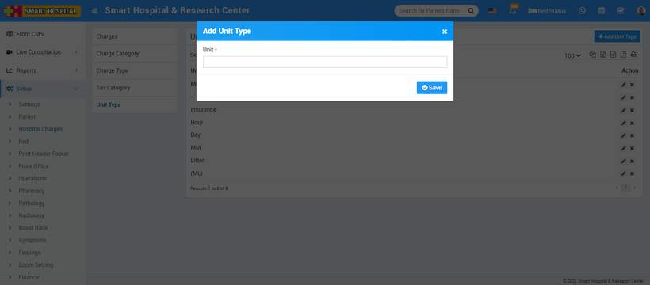
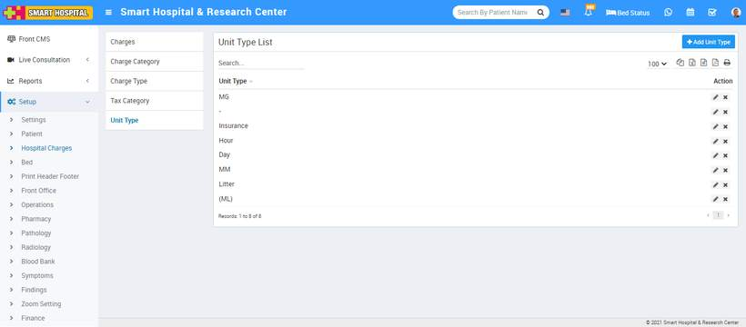
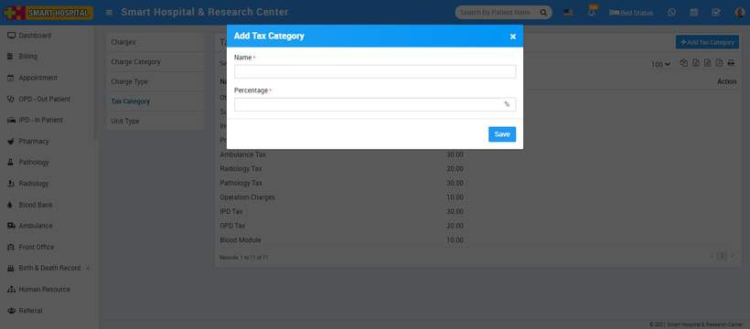
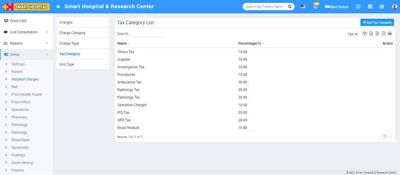
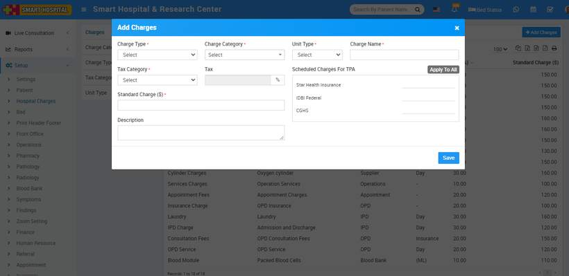
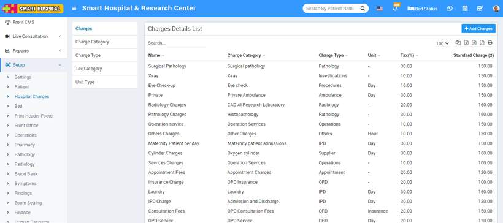

# Hospital Charges

_Tue, 09 Nov, 2021_ · [Setup & Configuration (22)](https://smart-hospital.in/category/setup-configuration) · vendor article: https://smart-hospital.in/article/hospital-charges

### Hospital Charges

Tue, 09 Nov, 2021

[Articles](https://smart-hospital.in/articles)[Setup & Configuration](https://smart-hospital.in/category/setup-configuration)

---

To add Charges for OPD or IPD patients first you should create **Charges type** and **Charges Categories** in Smart Hospital.  
 **Charge Type**

To add Hospital Charges, here first we add Charge Type, for this click on **+ Add Charge Type** button. Now enter **Charge Type** and select Module for which you want apply this charge type then click on **Save** button.  
  

Here in Charge Type you will get 5 default charge types those are Procedure**, Investigations, Supplier, Operation Theatre** and **Others**. And your added new charge type will show in charge type list.

To delete **Charge Type** click on delete icon present at **Action** column.  
  

---

### **Charge Category**

Now we will add Charge Category, for this click on **+ Add Charge Category** button. Now enter **Name, Description** and select **Charge Type** like Procedures (is for general ipd charges like doctor visit), Investigations (is for pathology/radiology lab test or other investigations), Supplier (is for other things supply like oxygen charges), Operation Theatre (is for operation theatre charges) and Other (is for other miscellaneous charges).  
  

You can check this added record at **Charge Category List** page.  
  

To edit Charge Category click on edit icon and to delete **Charge Category** click on the delete icon present at the **Action** column.

---

### **Unit Type**

Now we will add **Unit Type** for this click on **+ Add Unit Type** button. Now enter **Unit** and click on **Save** button.  
  

Your added Unit type record will show at **Unit Type List** page.  
  

To edit **Unit Type** click on edit button and to delete **Unit Type** click on delete button present at **Action** column.

---

### **Tax Category**

To add Tax Category click on **+Add Tax Category** button then enter **Tax name** and **Percentage** and click on **Save** button**.  
  
**

Your added Tax Category record will show at T**ax Category List** page.  
  

To edit Tax Category click on edit icon and to delete **Tax Category** click on delete icon present at **Action** column (icon will show on mouseover).

---

### **Charges**

Now we will add Charges for this click on **+ Add Charge** button. Now enter **Charge Type, Charge Category, Unit Type (like ML), Charge Nam, Tax Category**  then enter **Standard Charge, Description** and if there is any **TPA (Third Party Administrator or Insurance organization)** is present then enter Scheduled Charges For TPA also) and click on **Save** button.  
  
  

Your added record will be show at **Charges Details List** page.  
  

