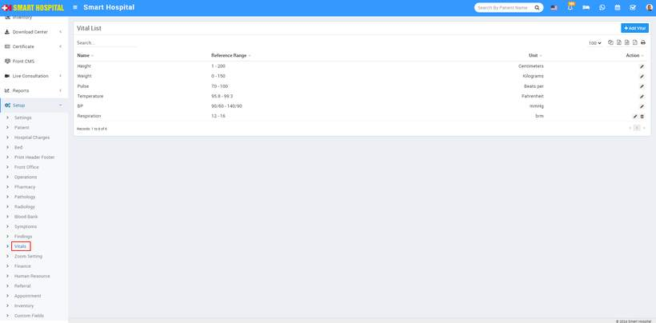
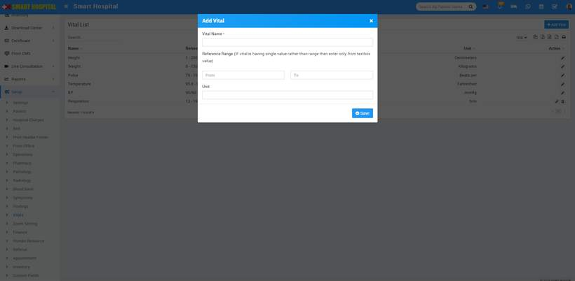
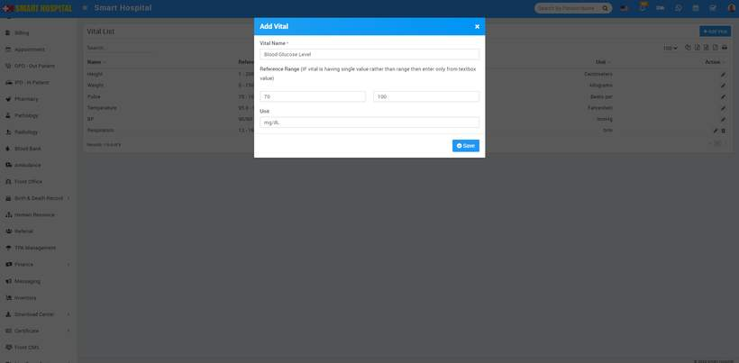
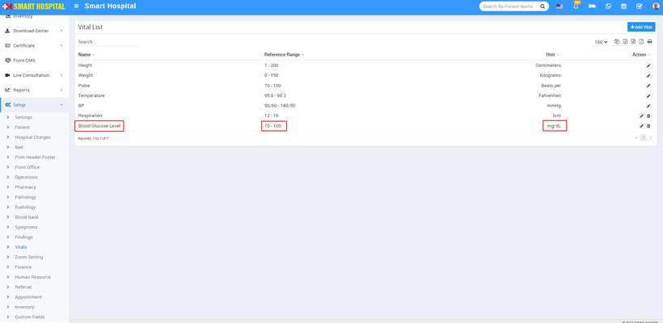

# How to create a master of vitals and their reference ranges?

_Fri, 30 Aug, 2024_ · [Setup & Configuration (22)](https://smart-hospital.in/category/setup-configuration) · vendor article: https://smart-hospital.in/article/how-to-create-a-master-of-vitals-and-their-reference-ranges

### How to create a master of vitals and their reference ranges?

Fri, 30 Aug, 2024

[Articles](https://smart-hospital.in/articles)[Setup & Configuration](https://smart-hospital.in/category/setup-configuration)

---

To create the master of vitals, simply go to the **Setup > Vitals**, when you click on vitals, vitals list will be open on the right side  
  
  
  
To add the master of the vitals simply go to the top right side **Add Vitals** button, and click on it **Add Vital** window will be open   
  
  
  
Now enter the **Vitals Name, Reference Range** and **Unit** then click on **Save** button Vitals details will be add in the **Vitals List**   
  
  
  
In this vital list you can see the details of the vitals which we recently added   
  
  
  
If you want to Edit the list you can click on edit icon, and update the details
