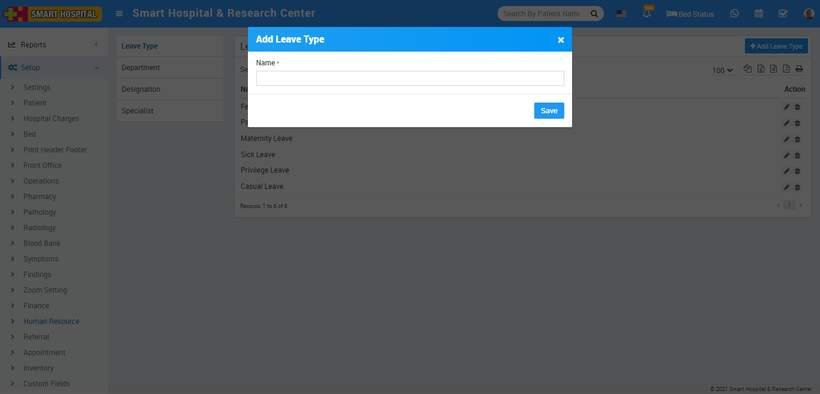
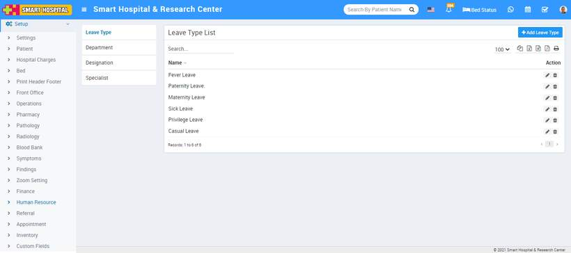
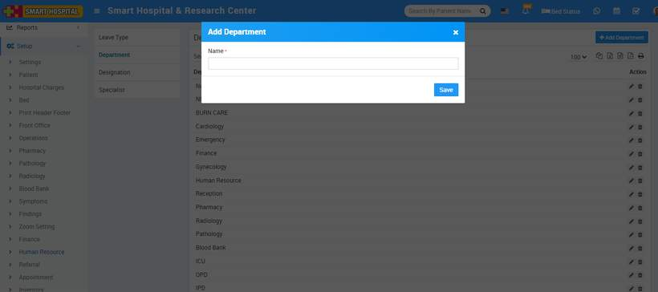
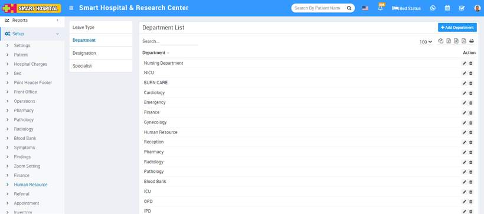
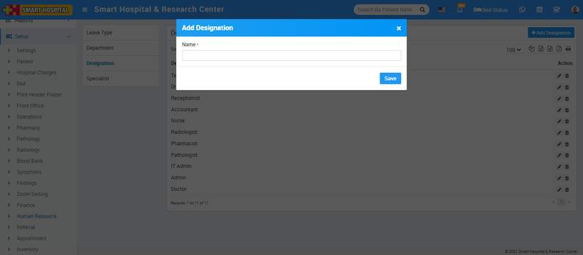
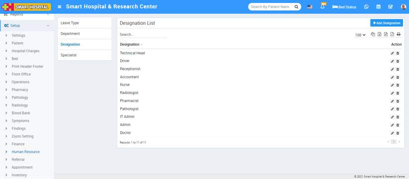
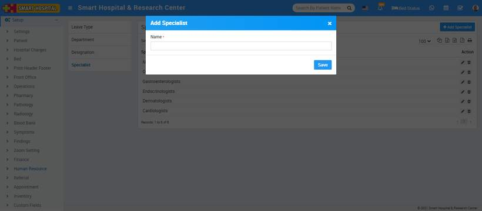
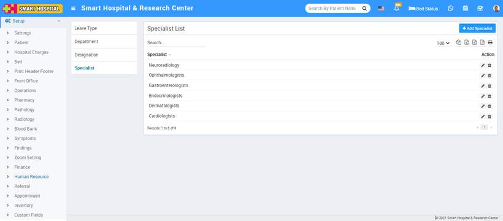

# Human Resource

_Sun, 31 Oct, 2021_ · [Setup & Configuration (22)](https://smart-hospital.in/category/setup-configuration) · vendor article: https://smart-hospital.in/article/human-resource

### Human Resource

Sun, 31 Oct, 2021

[Articles](https://smart-hospital.in/articles)[Setup & Configuration](https://smart-hospital.in/category/setup-configuration)

---

To setup Human Resource go to **Setup > Human Resource**.

### **Leave Type**

To add **Leave Type** click on **+ Add** **Leave Type** button now enter Name and click on **Save** button.  
  

You can check added **Leave Type** record at **Leave Type** List page.  
  

To edit **Leave Type** click on edit and to delete **Leave Type** click on delete icon present at Action column.

---

### **Department**

To add **Department** click on + Add **Department** button now enter Name and click on Save button.  
  

You can check added **Department** record at **Department** List page.  
  

To edit **Department** click on edit and to delete **Department** click on delete icon present at Action column.

---

### **Designation**

To add **Designation** click on **+ Add** **Designation** button now enter Name and click on Save button.  
  

You can check added **Designation** record at **Designation** List page.  
  

To edit **Designation** click on edit and to delete **Designation** click on delete icon present at Action column.

---

### **Specialist**

To add **Specialist** click on **+ Add** **Specialist** button now enter Name and click on Save button.  
  

You can check added **Specialist** record at **Specialist** List page.  
  

To edit **Specialist** click on edit and to delete **Specialist** click on delete icon present at Action column.
