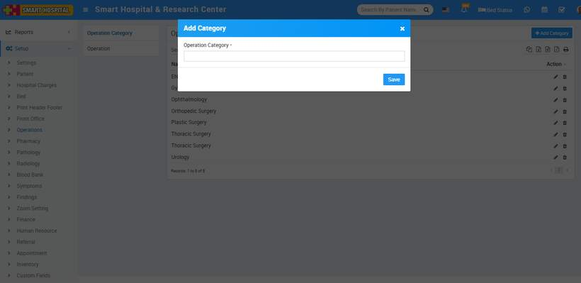
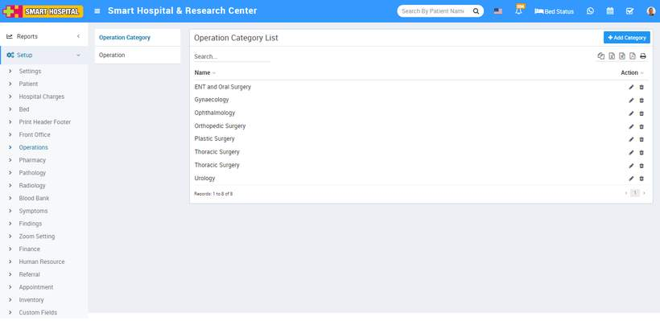
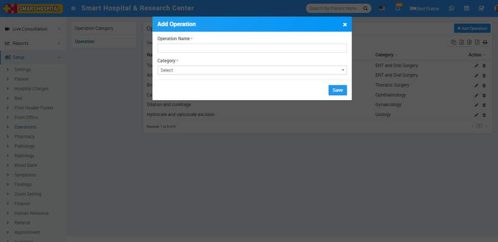
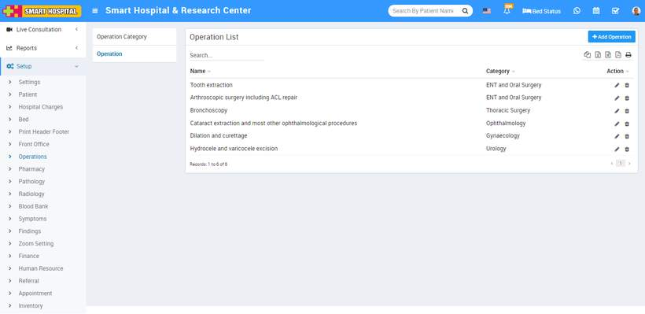

# Operations

_Sun, 31 Oct, 2021_ · [Setup & Configuration (22)](https://smart-hospital.in/category/setup-configuration) · vendor article: https://smart-hospital.in/article/operations

### Operations

Sun, 31 Oct, 2021

[Articles](https://smart-hospital.in/articles)[Setup & Configuration](https://smart-hospital.in/category/setup-configuration)

---

To setup Operation Theatre type and Categories go to **Setup > Operation Theatre**, here first we should add **Operation Theatre Category** then add **Type**.

### **Operation Theater Category**

To add Operation Category click on **+ Add Category** button now enter **Operation Category** and click on **Save** button.  
  

You can check added Operation Category record at **Operation Category List** page.  
  

To edit Operation Category click on edit and to delete Operation Category click on delete icon present at **Action** column.

---

### **Operation**

To add Operation click on **+ Add Operation** button now enter **Operation Name** and **Category** then click on **Save** button.  
  

You can check added Operation record at **Operation List** page.  
  

To edit Operation click on edit and to delete Operation click on delete icon present at **Action** column.
