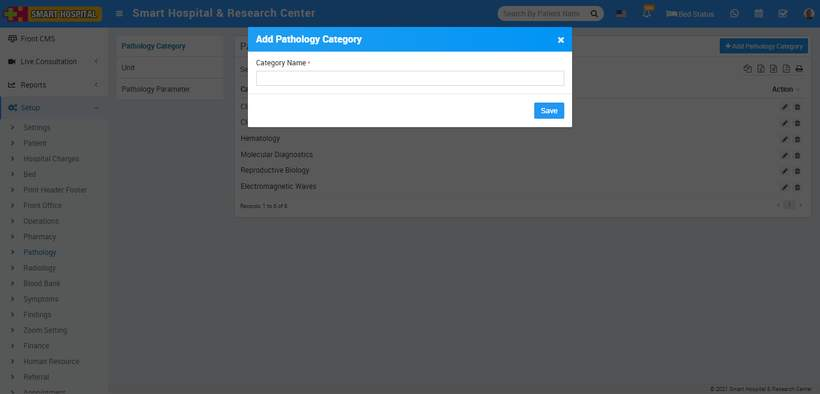
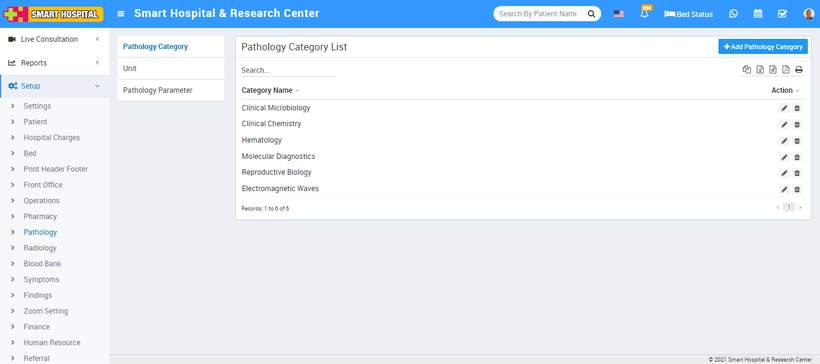
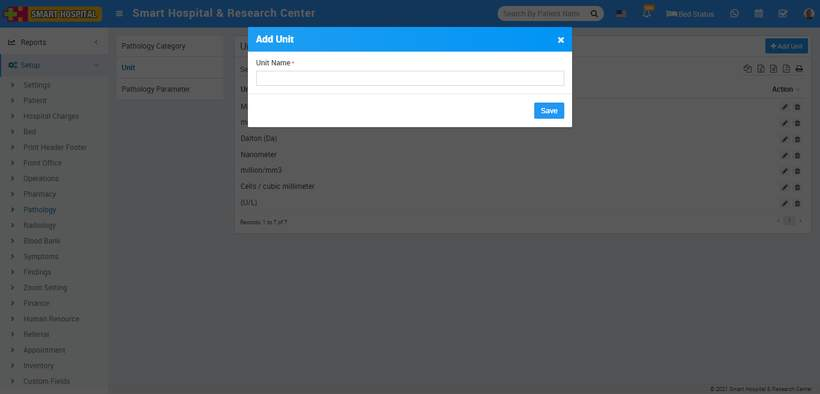
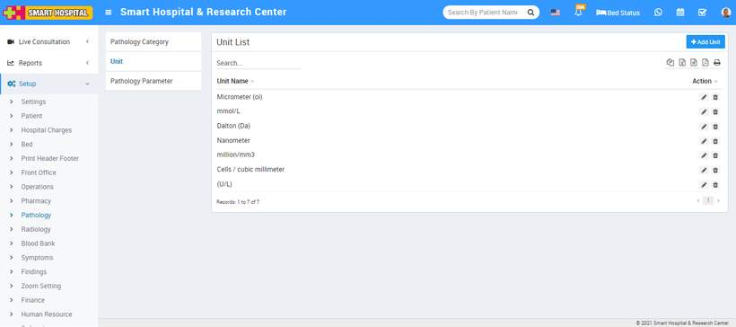
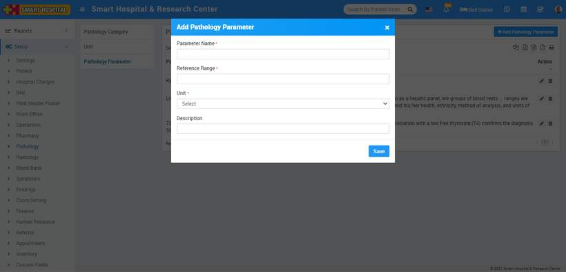
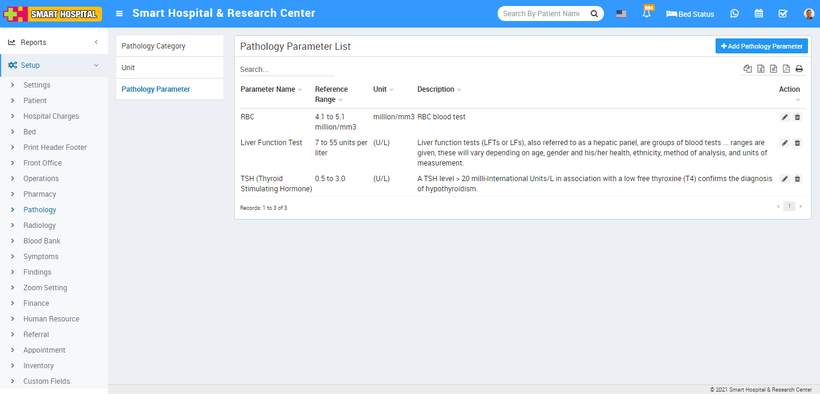

# Pathology

_Sun, 31 Oct, 2021_ · [Setup & Configuration (22)](https://smart-hospital.in/category/setup-configuration) · vendor article: https://smart-hospital.in/article/pathology

### Pathology

Sun, 31 Oct, 2021

[Articles](https://smart-hospital.in/articles)[Setup & Configuration](https://smart-hospital.in/category/setup-configuration)

---

To setup Pathology go to **Setup > Pathology**.  
  

### **Pathology Category**

To add Pathology Category Type click on **+ Add Pathology Category** button now enter **Pathology Category Name** and click on **Save** button.  
  

You can check added Pathology Category record at **Pathology Category List** page.  
  

To edit Pathology Category click on edit and to delete Pathology Category click on delete icon present at **Action** column.  

---

### **Unit**

To add Unit Type click on **+ Add Unit** button now enter **Unit Name** and click on **Save** button.  
  

You can check added Unit record at **Unit List** page.  
  

To edit Unit click on edit and to delete Unit click on delete icon present at **Action** column.  
  

---

### **Pathology Parameter**

To add Pathology Parameter Type click on **+ Add Pathology Parameter** button now enter **Pathology Parameter Name Reference Range, Unit, Description** and click on **Save** button.  
  

You can check added Pathology Parameter record at **Pathology Parameter List** page.  
  

To edit Pathology Parameter click on edit and to delete Pathology Parameter click on delete icon present at **Action** column.
