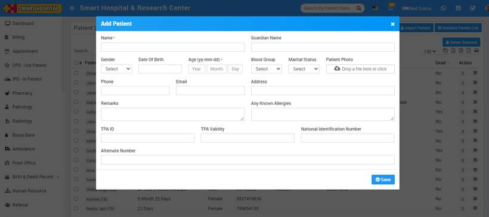
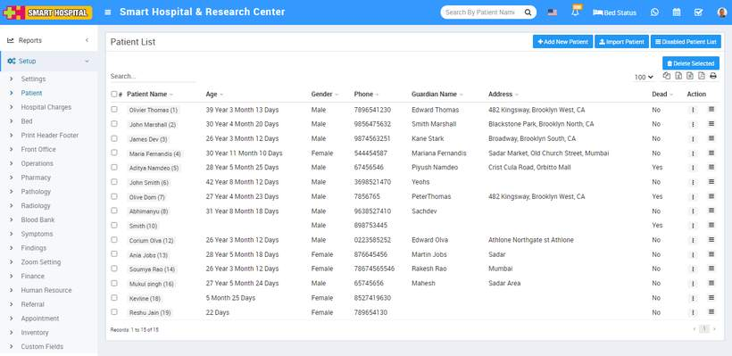
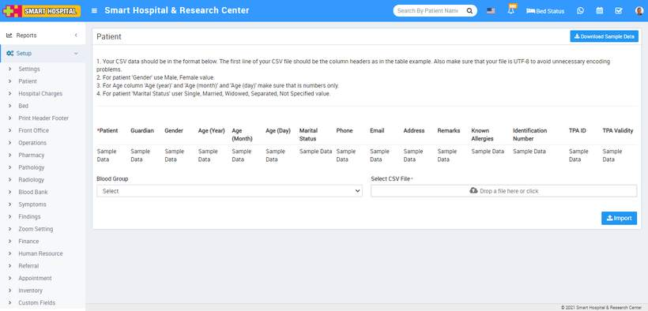
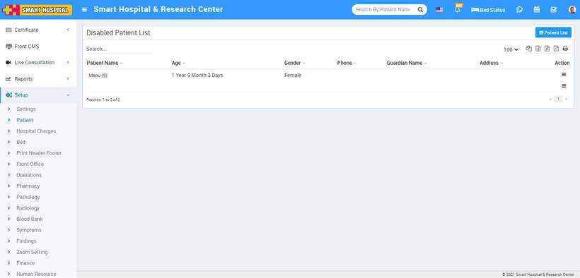

# Patient

_Sat, 30 Oct, 2021_ · [Setup & Configuration (22)](https://smart-hospital.in/category/setup-configuration) · vendor article: https://smart-hospital.in/article/patient

### Patient

Sat, 30 Oct, 2021

[Articles](https://smart-hospital.in/articles)[Setup & Configuration](https://smart-hospital.in/category/setup-configuration)

---

Here you can manage patient's profile data like add, edit, import, enable, disable and delete patient. You can also delete multiple patients through Delete Selected button option.   
  
To add new patient **+Add New Patient** button, here enter patient Name, Guardian Name, Gendar, Date of Birth, Age, Phone etc details and click on **Save** button. You can see this added patient record in Patient List page.  
  

From patient list you can also directly switch to other modules (like OPD, IPD) where patient record exist. For this at Action column there is show option available.  
  

---

### **Import Patient**

To import patient, go to**Setup > Patient** click on the **Import Patient** button present at top right corner on right side in the patient page, at click of this button page will be open.  
  
You have to follow all the necessary instructions given here to create CSV file. Here you can also add multiple patients at the same time for this, you have to create a CSV file format. You can also download the sample file from top right corner by clicking on **Download Sample Import** **File** button.  
  
You shouldn’t delete the first row of CSV file. It is necessary to fill the required field in this file.

After completing the file editing, here select the **Blood Group** and then you have to select this CSV file on **Select CSV File** option and then click on **Import Patient** button.  
  

---

### **Disabled Patient**

  
Disabled Patient is for seeing all disabled patient. To see disabled patient list go to **Setup > Patient > Disabled Patient List**.  
  
  
  
To check disabled patient detail click on show button present at **Action** column.
