# Pharmacy

_Sat, 25 May, 2024_ · [Setup & Configuration (22)](https://smart-hospital.in/category/setup-configuration) · vendor article: https://smart-hospital.in/article/pharmacy

### Pharmacy

Sat, 25 May, 2024

[Articles](https://smart-hospital.in/articles)[Setup & Configuration](https://smart-hospital.in/category/setup-configuration)

---

To setup Pharmacy go to **Setup > Pharmacy**.  
  

### **Medicine Category**

To add Medicine Category click on **+ Add Medicine Category** button now enter Category Name and click on save button.  
  
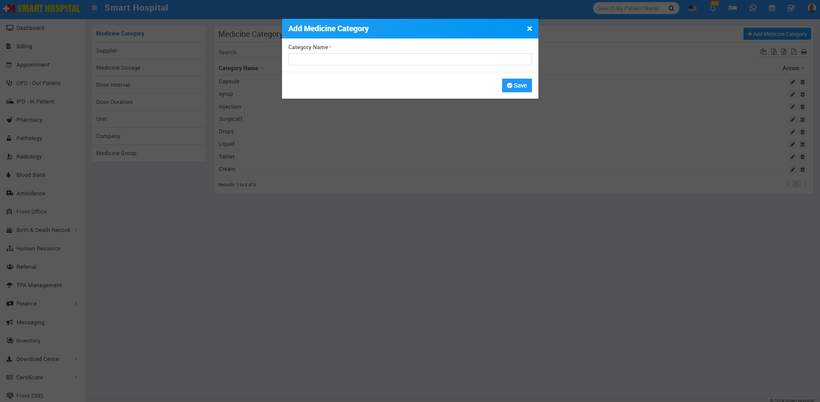

You can check added Medicine Category record at **Medicine Category List** page.  
  
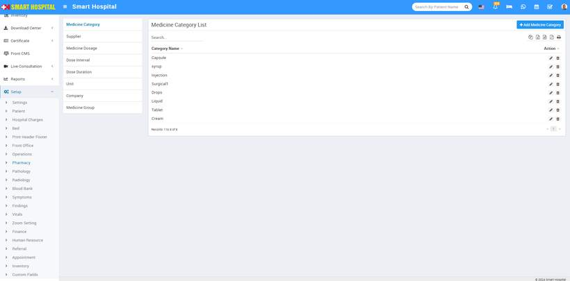

To edit Medicine Category click on edit and to delete Medicine Category click on delete icon present at **Action** column.  
  

---

### **Supplier**

To add Supplier click on **+ Add** **Supplier** button now enter **Supplier Name, Supplier Contact, Contact Person Name, Contact Person Phone, Drug Licence Number, Address** and click on **Save** button.  
  
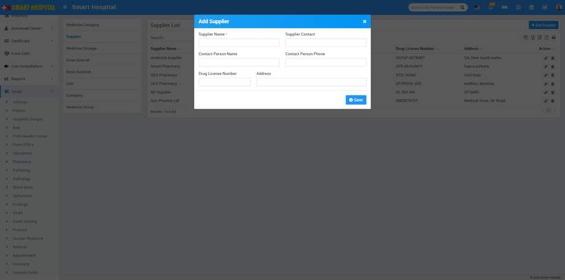  
  
You can check added Supplier record at **Supplier List** page.  
  
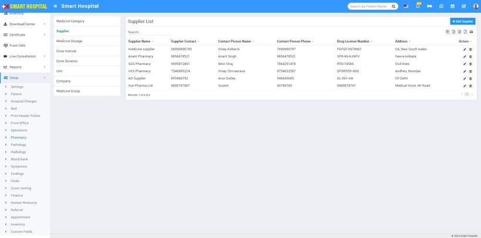

To edit Supplier click on edit and to delete Supplier click on delete icon present at **Action** column.  
  
  

---

### **Medicine Dosage**

To add Medicine Dosage click on **+ Add Medicine Dosage** button now enter **Medicine Category, Dose, Unit** and click on **Save** button. If you want to add more Dose at once then click on **+Add** button.  
  
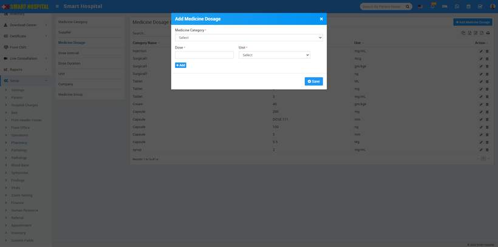  
  
You can check added Medicine Dosage record at **Medicine Dosage List** page.  
  
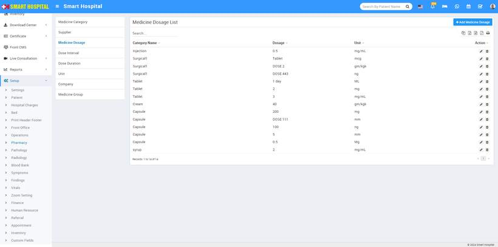  
  
To edit Medicine Dosage click on edit and to delete Medicine Dosage click on delete icon present at **Action** column.

---

### **Dose Interval**

To add Dose Interval click on **+ Add Dose Interval** button now enter **Interval** detail and click on **Save** button.  
  
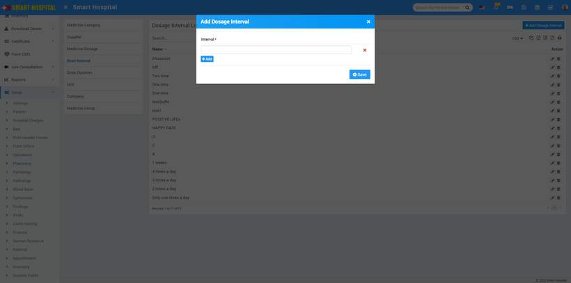  
  
You can check added Dose Interval record at **Dose Interval List** page.  
  
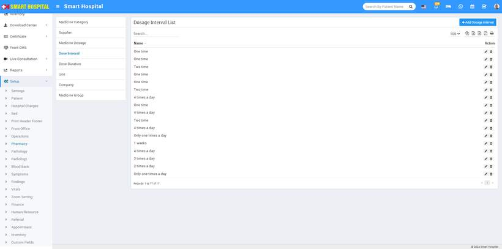  
To edit Dose Interval click on edit and to delete Dose Interval click on delete icon present at **Action** column.

---

### **Dose Duration**

To add Dose Duration click on **+ Add Dose Duration** button now enter Interval detail and click on **Save** button.  
  
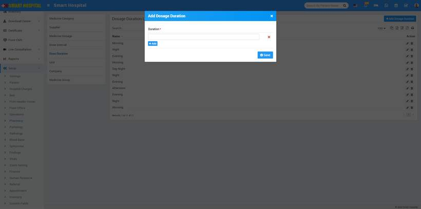  
  
You can check added Dose Duration record at **Dose Duration List** page.  
  
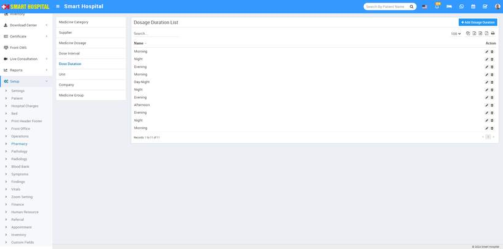  
  
To edit Dosage Duration click on **Edit** and to delete Dosage Duration click on **Delete** icon present at **Action** column.

---

### **Unit**

To add Unit click on **+ Add Unit** button now enter unit name and click on Save button.  
  
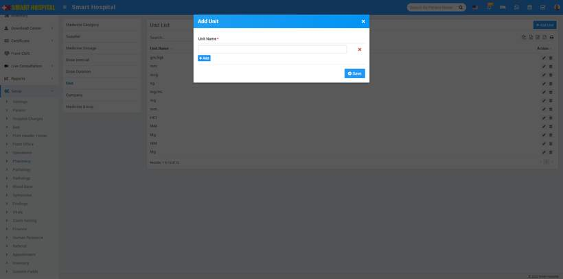  
  
You can check added Unit record at **Unit List** page.  
  
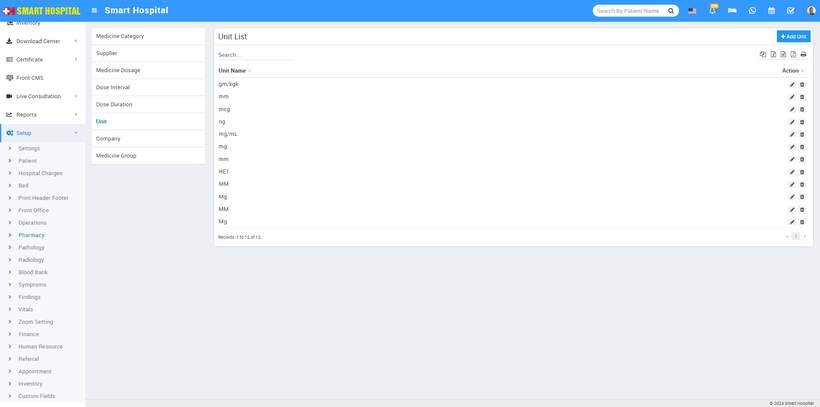  
  
To edit Unit click on **Edit** and to delete Unit click on **Delete** icon present at **Action** column.

---

### **Company**

To add Company click on **+ Add Company** button now enter **Company Name** and click on **Save**button.  
  
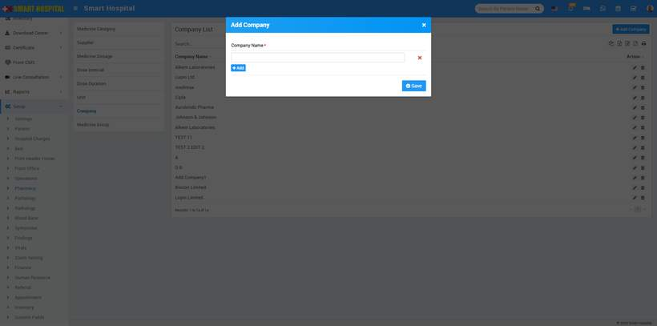  
  
You can check added **Company Name** at Company**List** page.  
  
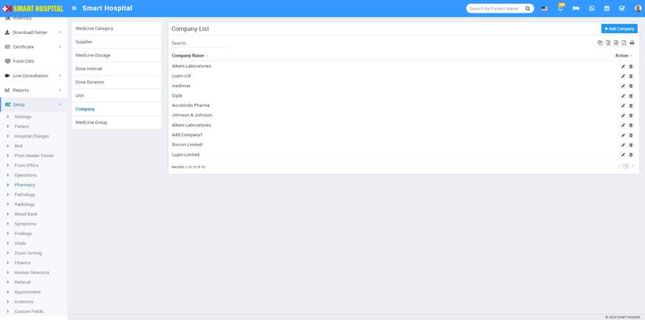  
  
To edit **Company Name** click on **Edit** and to delete **Company Name** click on **Delete** icon present at **Action** column.

---

### **Medicine Group**

To add Medicine Group click on **+ Add Medicine Group** button now enter **Medicine Group Name** and click on **Save**button.  
  
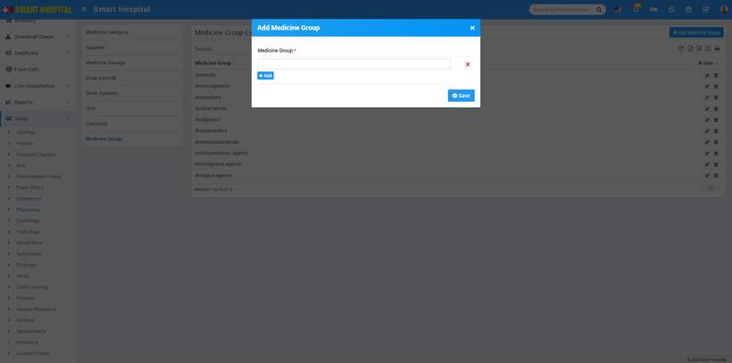  
  
You can check added **Medicine Group** name at **Medicine Group** **List** page.  
  
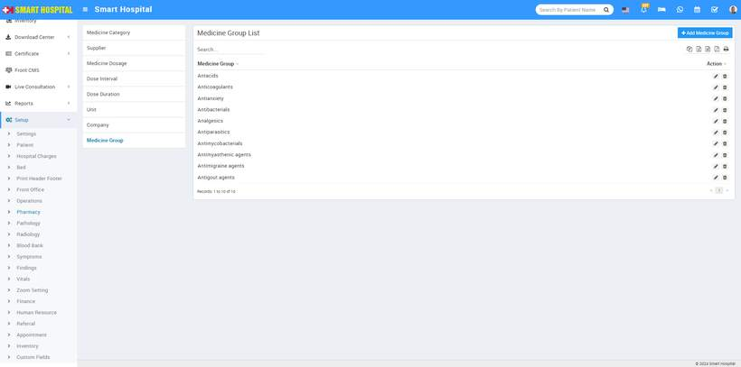
