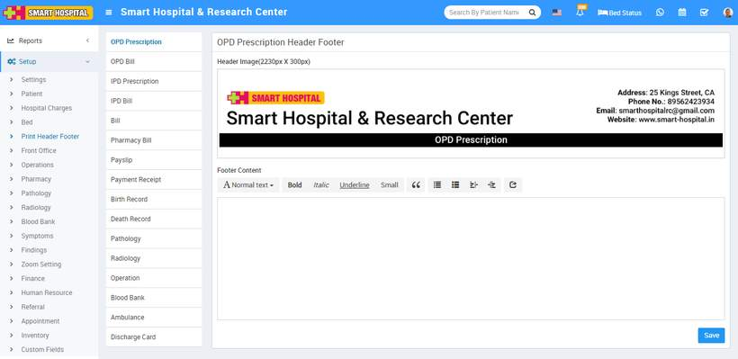

# Print Header Footer

_Sat, 30 Oct, 2021_ · [Setup & Configuration (22)](https://smart-hospital.in/category/setup-configuration) · vendor article: https://smart-hospital.in/article/print-header-footer

### Print Header Footer

Sat, 30 Oct, 2021

[Articles](https://smart-hospital.in/articles)[Setup & Configuration](https://smart-hospital.in/category/setup-configuration)

---

For adding header and footer in OPD prescription, IPD Bill, Pharmacy Bill, Payslip go to **Setup > Print Header Footer**.

You can add Header and Footer for different modules. To add it click on **+ Add** button now select Header image then enter Footer text.  
  

You can add Header and Footer for below mentioned modules -

* OPD Prescription
* IPD Prescription
* IPD Bill
* Pharmacy Bill
* Payslip
* Payment Receipt
* Birth Record
* Death Record
* Pathology
* Radiology
* Operation Theatre
* Blood Bank
* Ambulance
* Discharge Card
