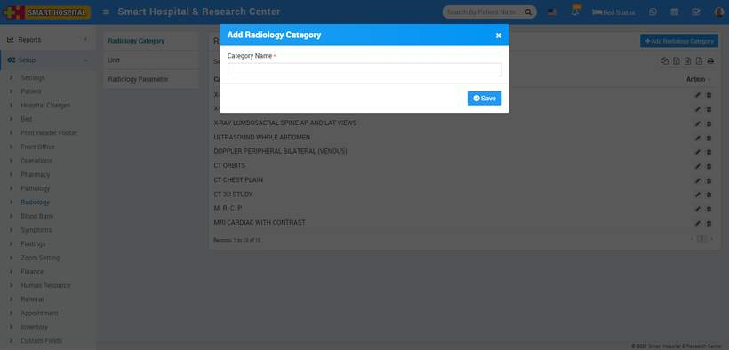
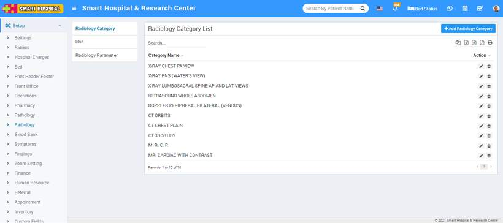
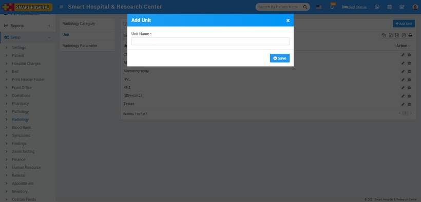
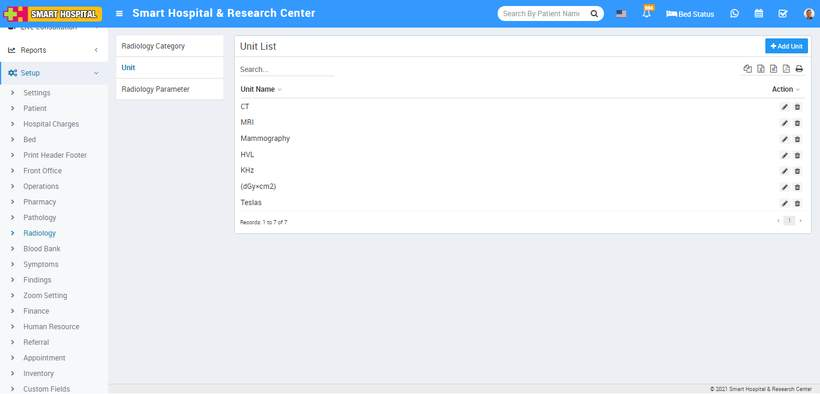
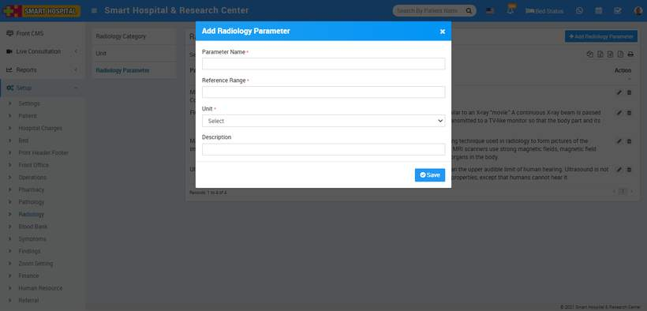
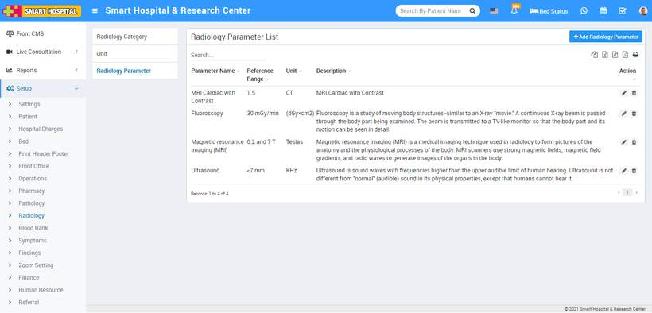

# Radiology

_Sun, 31 Oct, 2021_ · [Setup & Configuration (22)](https://smart-hospital.in/category/setup-configuration) · vendor article: https://smart-hospital.in/article/radiology

### Radiology

Sun, 31 Oct, 2021

[Articles](https://smart-hospital.in/articles)[Setup & Configuration](https://smart-hospital.in/category/setup-configuration)

---

To setup Pathology go to **Setup > Radiology**.  
  

### **Radiology Category**

To add Radiology Category Type click on **+ Add Radiology Category** button now enter **Radiology** **Category Name** and click on **Save** button.  
  

You can check added Radiology Category record at **Radiology** **Category List** page.  
  

To edit Pathology Category click on edit and to delete Radiology Category click on delete icon present at **Action** column.  

---

### **Unit**

To add Unit Type click on **+ Add Unit** button now enter **Unit Name** and click on **Save** button.  
  

You can check added Unit record at **Unit List** page.  
  

To edit Unit click on edit and to delete Unit click on delete icon present at **Action** column.  
  

---

### **Radiology Parameter**

To add Radiology Parameter Type click on **+ Add Radiology Parameter** button now enter **Radiology** **Parameter Name, Reference Range, Unit, Description** and click on **Save** button.  
  

You can check added Radiology Parameter record at **Radiology** **Parameter List** page.  
  

To edit Pathology Parameter click on edit and to delete Radiology Parameter click on delete icon present at **Action** column.
