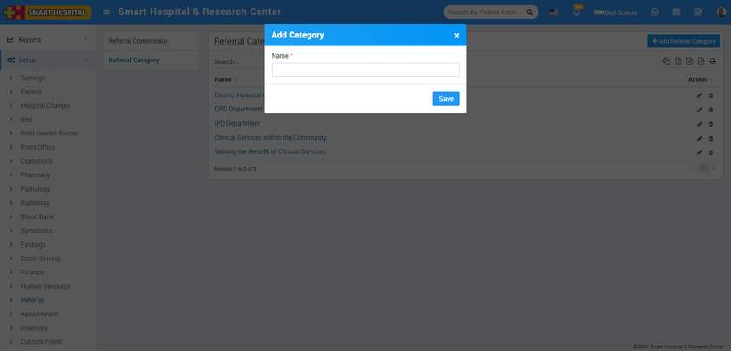
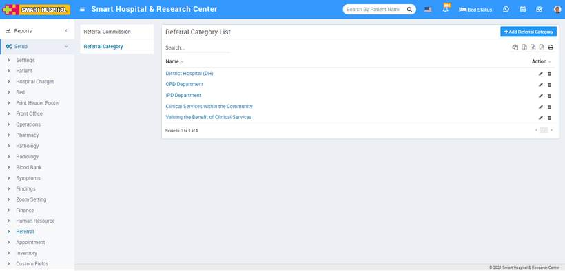
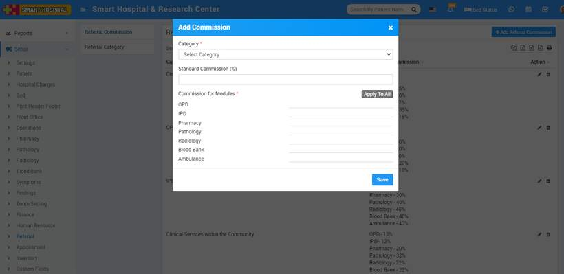
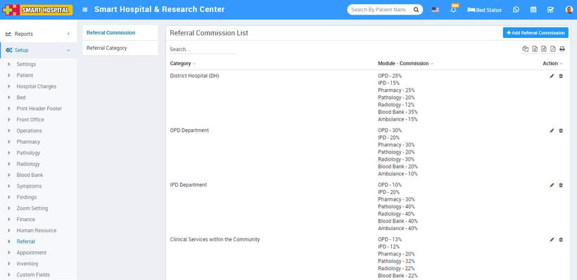

# Referral

_Sun, 31 Oct, 2021_ · [Setup & Configuration (22)](https://smart-hospital.in/category/setup-configuration) · vendor article: https://smart-hospital.in/article/referral

### Referral

Sun, 31 Oct, 2021

[Articles](https://smart-hospital.in/articles)[Setup & Configuration](https://smart-hospital.in/category/setup-configuration)

---

To setup Referral go to **Setup > Referral**. Here first we have to create **Referral Category** then we can create **Referral Commission**.  
  

### **Referral** **Category**

To add Referral Category click on **+ Add Referral** **Category** button now enter **Name** and click on **Save** button.  
  
  
  
You can check added Referral Category record at **Referral Category List** page.  
  
  
  
To edit Referral Category click on edit and to delete Referral Category click on delete icon present at **Action** column.

---

### **Referral Commission**

Now to add Referral Commission click on **+ Add Referral Commission** button now enter **Category**, **Standard Commission, Commission** for Modules and click on **Save** button.  
  
  
  
You can check added Referral Commission record at **Referral Commission List** page.  
  

  
  
To edit Referral Commission click on edit and to delete Referral Commission click on delete icon present at **Action** column.  

---
