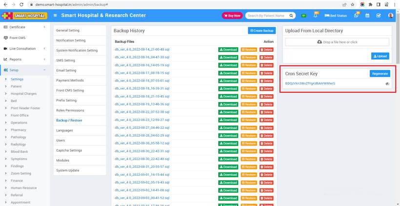
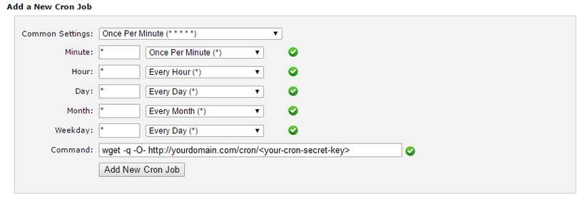

# Setup Cron Job in cPanel

_Wed, 11 Jan, 2023_ · [Setup & Configuration (22)](https://smart-hospital.in/category/setup-configuration) · vendor article: https://smart-hospital.in/article/setup-cron-job-in-cpanel

### Setup Cron Job in cPanel

Wed, 11 Jan, 2023

[Articles](https://smart-hospital.in/articles)[Setup & Configuration](https://smart-hospital.in/category/setup-configuration)

---

Cron setup is required for Smart Hospital if you want **Create Database Backup** will work automatically.  
  
Go to **System > Settings > Backup Restore** and generate your Smart Hospital **Cron Secret Key**. It will be used to configure Cron Job in cPanel.  
  
  
  
**Login to your cPanel and navigate to Cron jobs**  
  
Add the following settings -  
  
  
Change the URL according to your base URL. If your base URL starts with https://, make sure that you configure the cron job URL to start with https://  
  
This will check for Fees Reminder and Create Database Backup to every minute. If you want to change the frequency of Cron Job then change settings for timings.  
  
If you want to configure **Create Database Backup Automatically** them in Command field enter url -   
**wget -q -O- http://yourdomain.com/cron/autobackup/<your-cron-secret-key>**
