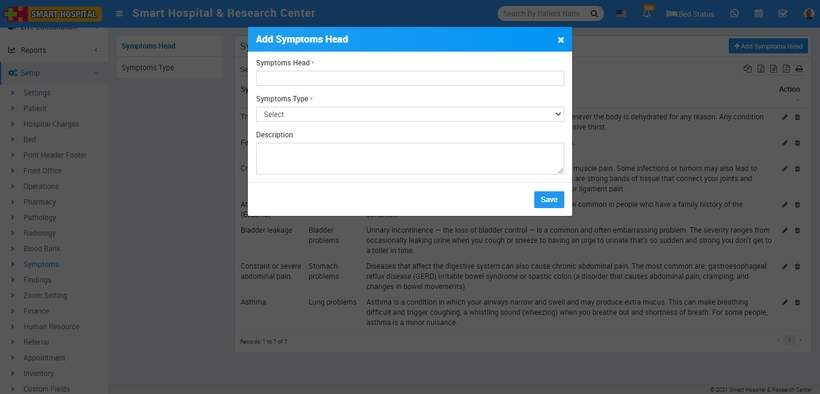
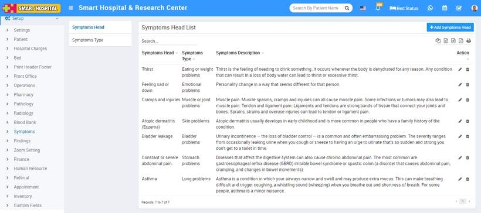
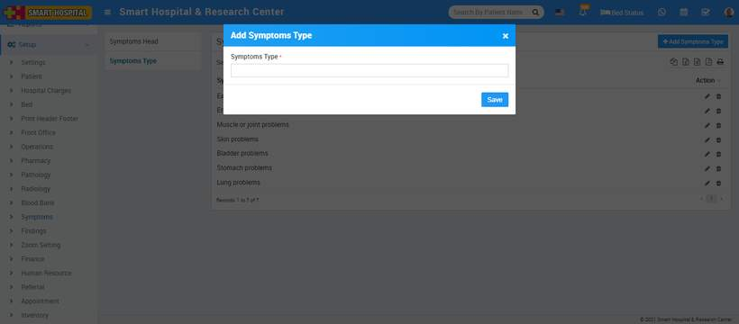
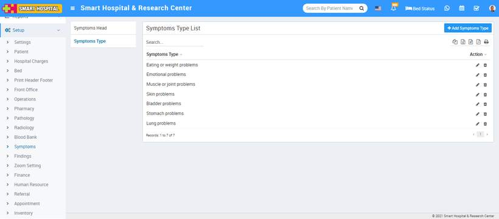

# Symptoms

_Sat, 30 Oct, 2021_ · [Setup & Configuration (22)](https://smart-hospital.in/category/setup-configuration) · vendor article: https://smart-hospital.in/article/symptoms

### Symptoms

Sat, 30 Oct, 2021

[Articles](https://smart-hospital.in/articles)[Setup & Configuration](https://smart-hospital.in/category/setup-configuration)

---

To setup Symptoms go to **Setup > Symptoms**.  
  

### **Symptoms Head**

To add Symptoms Head click on **+ Add Symptoms Head** button now enter **Symptoms Head Symptoms Type, Description** and click on **Save** button.  
  

You can check added Symptoms Head record at **Symptoms Head List** page.  
  

To edit Symptoms Head click on edit and to delete Symptoms Head click on delete icon present at **Action** column.  
  

### **Symptoms Type**

To add Symptoms Type click on **+ Add Symptoms Type** button now enter **Symptoms Type** and click on **Save** button.  
  

You can check added Symptoms Type record at **Symptoms Type List** page.  
  

To edit Symptoms Type click on edit and to delete Symptoms Type click on delete icon present at **Action** column.
