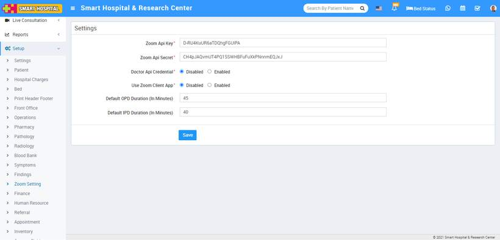

# Zoom Setting

_Sat, 30 Oct, 2021_ · [Setup & Configuration (22)](https://smart-hospital.in/category/setup-configuration) · vendor article: https://smart-hospital.in/article/zoom-setting

### Zoom Setting

Sat, 30 Oct, 2021

[Articles](https://smart-hospital.in/articles)[Setup & Configuration](https://smart-hospital.in/category/setup-configuration)

---

Before creating **Zoom Live Consultation or Live Meeting** you must have **Zoom account** and **Zoom API credentials**. If you don’t have zoom account or API credentials then check this <https://www.youtube.com/watch?v=voJOIavlKTk> video tutorial.  
To configure **Zoom Live** **Consultation**, go to **Setup > Zoom Setting**, here enter **Zoom API Key** , **Zoom API Secret** details and check **Doctor API Credential** and **Use** **Zoom Client App** Enable/Disable. You can also set Default OPD Duration (In Minutes) and Default IPD Duration (In Minutes) and then click on **Save** button. Here, entered API credentials is known as Global API Key in Smart Hospital. If you disable **Doctor  API Credential** option then Doctor will have to use global API key and will not be able to create their own API Credential and if you enable Doctor API Credential option then doctor can add their own API credentials from their doctor account by clicking on **Add Credential** button to create Live consultation  by using self API Key.

If you enable **Zoom Client App** option then user will have to install Zoom Client App in their machine and if you disable Zoom Client App option then user does not have to install anything, Consultation and Meeting will start on **Zoom Web SDK**. Zoom Web SDK is not as mature as Zoom Client App so may be some features will not work properly or missing in Zoom Web SDK so it is highly recommended to use Zoom Client App to avoid Zoom Web SDK issues and use full featured Zoom services.  
  

