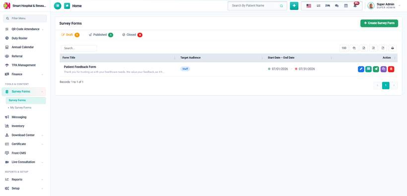

# About Survey Form

_Sat, 25 Jul, 2026_ · [Survey Form (6)](https://smart-hospital.in/category/survey-form) · vendor article: https://smart-hospital.in/article/about-survey-form

### About Survey Form

Sat, 25 Jul, 2026

[Articles](https://smart-hospital.in/articles)[Survey Form](https://smart-hospital.in/category/survey-form)

---

Survey Forms module is for building custom forms — feedback forms, satisfaction surveys, intake questionnaires, or any structured data you want to collect — and collecting responses from three different kinds of people, without writing any code.

Every form can be targeted at one or more of these audiences:

* **Staff** — the form appears under **Survey Forms → My Survey Forms** in the staff sidebar. Staff must be logged in.
* **Patient** — the form appears under **Survey Forms** in the patient portal. The patient must be logged in.
* **Front Site** — the form is published on the public hospital website with no login required at all, and can also be shared as a direct link or embedded as an iframe on any other page.

  
  

Each form moves through a simple status workflow: it starts as a **Draft** while you're still building it, becomes **Published** once it's ready to collect responses, and can be moved to **Closed** once you're done collecting responses — a closed form stops accepting new submissions but its existing responses and statistics remain visible.

A form cannot be published until it has at least one field added to it.

Once responses start coming in, every form gets its own **Submissions** dashboard with response statistics, a visual chart, and a detailed view of every individual submission.
