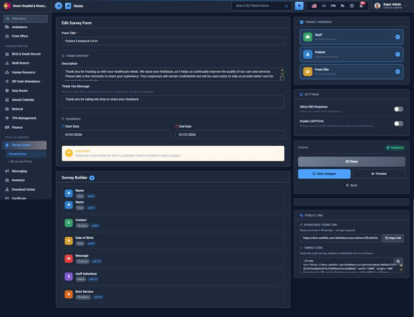

# How to add Fields to a Survey Form?

_Sat, 25 Jul, 2026_ · [Survey Form (6)](https://smart-hospital.in/category/survey-form) · vendor article: https://smart-hospital.in/article/how-to-add-fields-to-a-survey-form

### How to add Fields to a Survey Form?

Sat, 25 Jul, 2026

[Articles](https://smart-hospital.in/articles)[Survey Form](https://smart-hospital.in/category/survey-form)

---

Open a draft form from the Survey Forms list to reach the Edit page. Below the form details, the **Survey Builder** panel lists every field currently on the form and lets you add a new one, giving it a **Field Label**, a **Field Type**, an optional **Placeholder**, whether it is **Required**, and its column width on the form (full width or half width).  
  
  
  

The following field types are supported:

| Field Type | Description |
| --- | --- |
| **Text** | A single line of free text. |
| **Number** | A numeric input. |
| **Date** | A date picker. |
| **Textarea** | A multi-line free text box. |
| **Yes / No** | A simple two-option choice. |
| **Radio** | A single choice from your own custom options. |
| **Checkbox** | Multiple choices from your own custom options. |
| **Select** | A dropdown, single choice. |
| **File** | Lets the user attach a file or photo with their response. |

For **Radio**, **Checkbox** and **Select** fields, you can add as many options as you need, and even attach a small image to each option — useful for picture-based ratings.

Drag a field up or down using its handle to change the order in which it appears on the form. Click on a field to edit its label, type or options, or to delete it.

**Note:** Once a form is Published, its fields are locked to protect the responses already collected against them. Revert the form to Draft status first if you need to add, edit, or remove a field.
