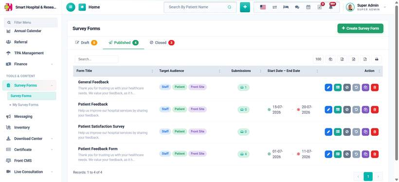
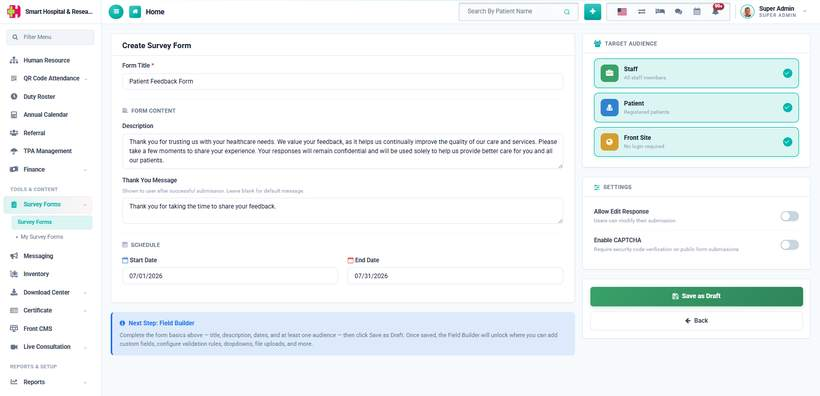

# How to create a Survey Form?

_Sat, 25 Jul, 2026_ · [Survey Form (6)](https://smart-hospital.in/category/survey-form) · vendor article: https://smart-hospital.in/article/how-to-create-a-survey-form

### How to create a Survey Form?

Sat, 25 Jul, 2026

[Articles](https://smart-hospital.in/articles)[Survey Form](https://smart-hospital.in/category/survey-form)

---

Go to **Survey Forms → Survey Forms** from the sidebar and click on the **+ Create Survey Form** button on the top right of the list page.

  
  

On the Create Survey Form page, enter the **Form Title**, an optional **Description** shown above the form fields, and a **Thank You Message** shown to the user after they submit — leave the thank you message blank to show a default message instead.

Under **Schedule**, you can optionally set a **Start Date** and **End Date** so the form is only open for a limited period. Under **Target Audience**, select at least one of **Staff**, **Patient** or **Front Site** — this decides who will see the form once it is published.

Two more settings are available under **Settings**:

* **Allow Edit Response** — lets a user who already submitted the form resubmit it, overwriting their previous answers.
* **Enable CAPTCHA** — adds a security code verification step on public form submissions.

  
  

Click **Save as Draft** once you are done. The form is created in **Draft** status and you are taken straight to the Edit page, where the **Survey Builder** unlocks so you can start adding fields.

**Note:** a form needs at least one Target Audience selected, and at least one field added, before it can be Published.
