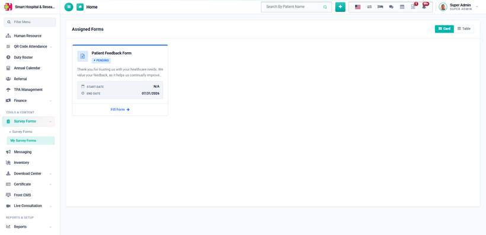
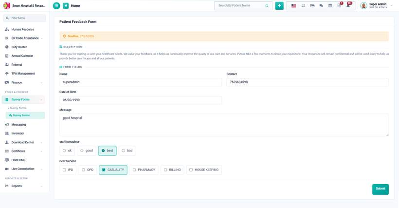
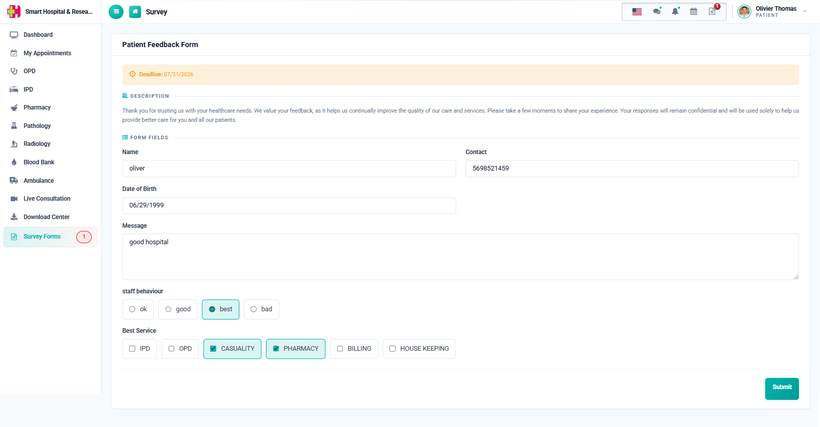
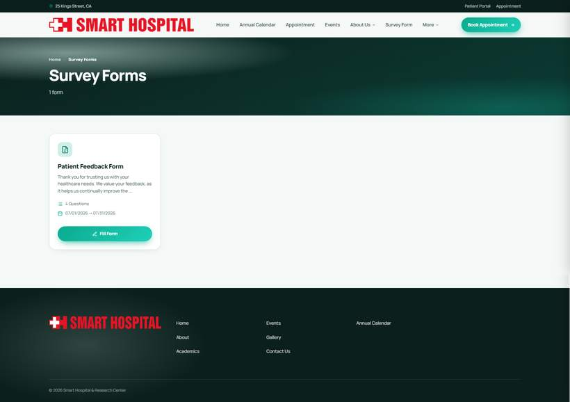
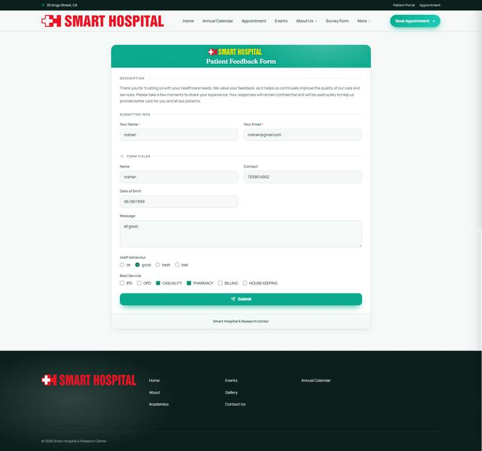

# How to fill a Survey Form? (Staff / Patient / Public)

_Sat, 25 Jul, 2026_ · [Survey Form (6)](https://smart-hospital.in/category/survey-form) · vendor article: https://smart-hospital.in/article/how-to-fill-a-survey-form-staff-patient-public

### How to fill a Survey Form? (Staff / Patient / Public)

Sat, 25 Jul, 2026

[Articles](https://smart-hospital.in/articles)[Survey Form](https://smart-hospital.in/category/survey-form)

---

Where a published form shows up depends on which Target Audience it was assigned to when it was created. The same form can appear in up to three different places at once.

## Staff

A staff member sees any form assigned to the **Staff** audience under **Survey Forms → My Survey Forms** in their own sidebar, with a red badge showing how many are still pending.  
  

Clicking **Fill Form** opens the form, deadline shown at the top if an end date was set. All fields are filled in and submitted the same way as any other form.  
  

## Patient

A patient sees any form assigned to the **Patient** audience under **Survey Forms** in the patient portal sidebar, again with a pending count badge.  
  
  

If **Allow Edit Response** was turned on for the form, both staff and patients can open it again after submitting and their new answers replace the old ones. Otherwise, the form shows a message that it was already submitted.

## Public (Front Site)

Anyone can reach a form assigned to the **Front Site** audience — no login needed — either from the public Survey Forms listing on the hospital website, or by opening the Public Link directly.  
  
  
  
Because there is no login on this side, the public form asks for the visitor's **Name** and **Email** under "Submitter Info" before the form's own questions — this is also how the system recognises a duplicate submission from the same person.  
  

