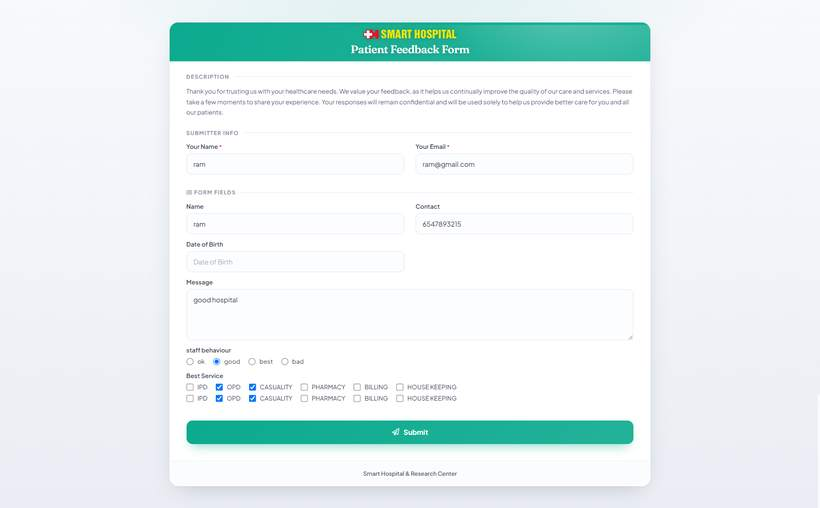
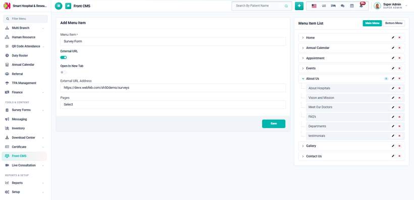

# How to Publish and Share a Survey Form?

_Sat, 25 Jul, 2026_ · [Survey Form (6)](https://smart-hospital.in/category/survey-form) · vendor article: https://smart-hospital.in/article/how-to-publish-and-share-a-survey-form

### How to Publish and Share a Survey Form?

Sat, 25 Jul, 2026

[Articles](https://smart-hospital.in/articles)[Survey Form](https://smart-hospital.in/category/survey-form)

---

Once your form has at least one field, click **Save changes** and then click the **Publish** button on the Edit page (shown as **Close** once already published, which is used to stop taking new responses later).

If **Front Site** was selected as a Target Audience, a **Public Link** and an **Embed Code** appear on the right side of the Edit page as soon as the form is saved — every form actually gets its own unique link the moment it is created, so this works even if you add the Front Site audience later.

* **Public Link** — a direct link that can be shared over email, WhatsApp, or SMS. Anyone with the link can open and fill the form without logging in.
* **Embed Code** — an `<iframe>` snippet you can paste into any external webpage to show the form directly on that page.

Both use the Copy button next to them to copy the link or code to your clipboard.  
  

## Adding it to your website menu

To show a proper "Survey Form" link in your website's navigation instead of only sharing the raw link, go to **Front CMS → Menu Item List**, click **Add Menu Item**, give it a name such as **Survey Form**, turn on **External URL**, and set the address to `/surveys` — this points to the public listing page that shows every form with the Front Site audience.  
  

