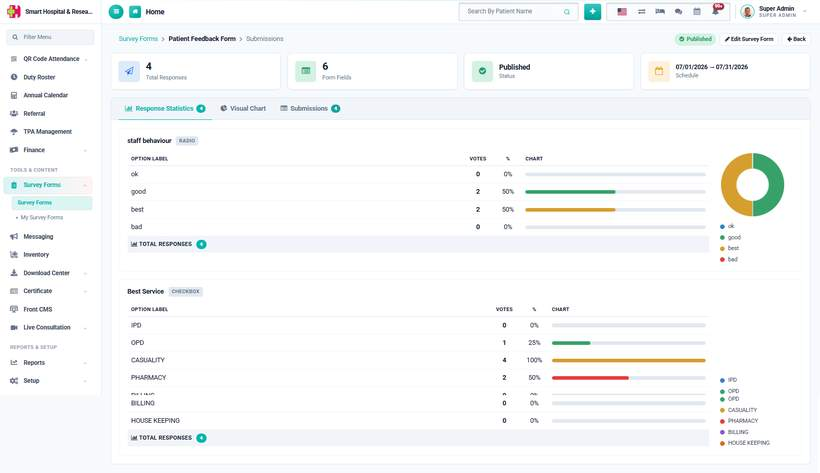
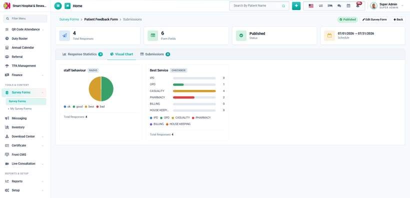
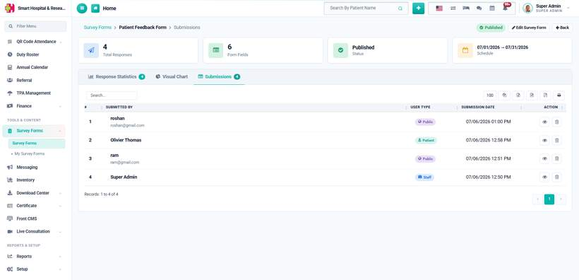
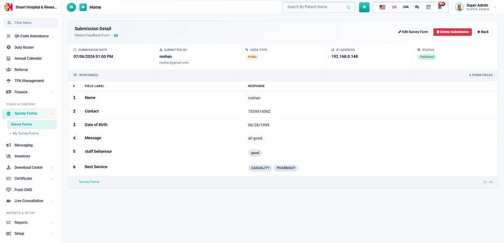

# How to view Survey Form Submissions?

_Sat, 25 Jul, 2026_ · [Survey Form (6)](https://smart-hospital.in/category/survey-form) · vendor article: https://smart-hospital.in/article/how-to-view-survey-form-submissions

### How to view Survey Form Submissions?

Sat, 25 Jul, 2026

[Articles](https://smart-hospital.in/articles)[Survey Form](https://smart-hospital.in/category/survey-form)

---

From the Survey Forms list, click the **View Submissions** action on any form to open its Submissions dashboard. The top of the page shows four quick summary tiles: **Total Responses**, **Form Fields**, **Status** and **Schedule**, followed by three tabs.

## Response Statistics

Every **Radio**, **Checkbox** and **Yes/No** field gets a breakdown of votes and percentage per option, with a bar and a donut chart. Free-text fields (**Text**, **Number**, **Date**, **Textarea**) instead list every answer that was submitted.  
  

## Visual Chart

A condensed, chart-only view of the same statistics — handy for a quick glance or for sharing a screenshot in a report.  
  

## Submissions

A full list of every response, with the submitter's name, an audience badge (**Staff**, **Patient** or **Public**), and the submission date. Click the eye icon on any row to open its full detail.  
  
  
  

