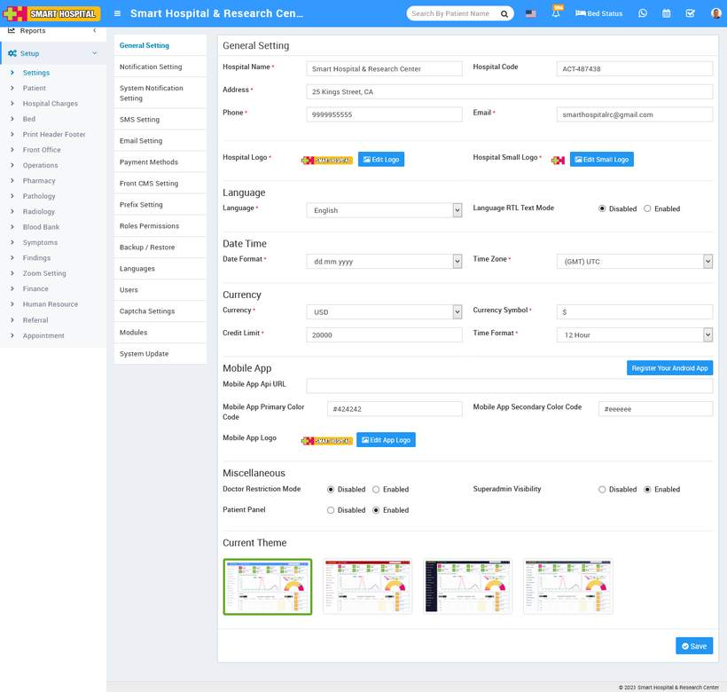

# About Settings

_Sun, 31 Oct, 2021_ · [System Settings (16)](https://smart-hospital.in/category/system-settings) · vendor article: https://smart-hospital.in/article/about-settings

### About Settings

Sun, 31 Oct, 2021

[Articles](https://smart-hospital.in/articles)[System Settings](https://smart-hospital.in/category/system-settings)

---

Settings is used to manage your website settings such as current themes, modules visibility, notifications etc. This module contain 15 sections – **General Setting, Notification Setting, System Notification Setting, SMS Setting, Email Setting, Payment Methods, Front CMS Setting, Prefix Setting, Roles Permissions, Backup/ Restore, Languages, Users, Captcha Settings, Modules, System Update** to manage website.  
  

