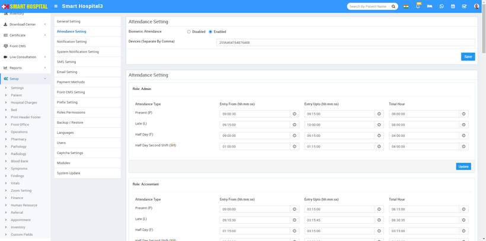
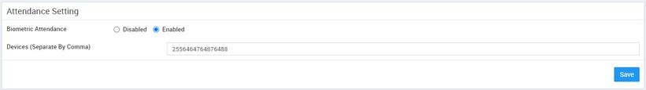
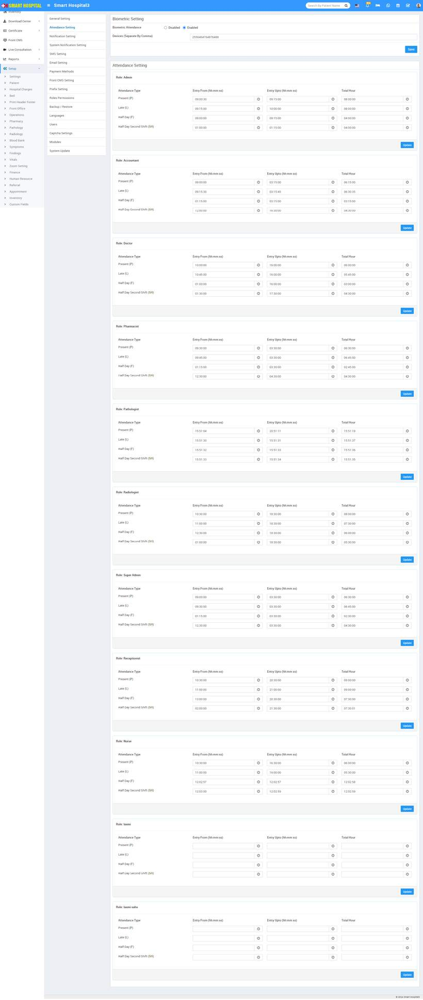

# Attendance Setting

_Fri, 30 Aug, 2024_ · [System Settings (16)](https://smart-hospital.in/category/system-settings) · vendor article: https://smart-hospital.in/article/attendance-setting

### Attendance Setting

Fri, 30 Aug, 2024

[Articles](https://smart-hospital.in/articles)[System Settings](https://smart-hospital.in/category/system-settings)

---

To Attendance Setting, simply go to the **Setup > Setting > Attendance Setting.  
  
**By using the Biometric Attendance setting, you can enable or disable attendance. In the 'Devices' field below, separated by commas, you need to fill in the biometric device serial numbers. If you want to use multiple biometric devices, simply add their serial numbers separated by commas (e.g., 2556464764876488, 2556464764876489)  
  
  
  
In the Attendance Setting below, you can see role-wise attendance settings available. In this setting, you can see Attendance types (Present, Late, Half Day, Half Day Second Shift), Entry From, Entry Up To, and Total Hours. Simply enter the time you want to keep role-wise or the same for all staff, and click on Update button individually. When any staff member marks their attendance, it will be saved according to the time you set in this setting.  
  
  
  
**Note:** In Attendance Setting, there are no mandatory fields for any role to set the attendance timing. If you want to keep the fields blank, you can, but then you will need to manage the attendance time from the **Human Resource > Staff Attendance page**
