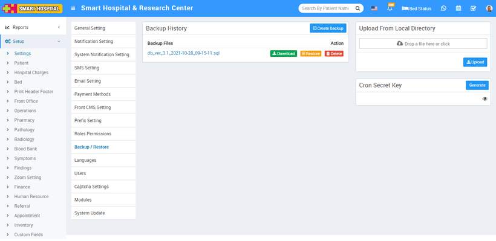

# Backup / Restore

_Wed, 11 Jan, 2023_ · [System Settings (16)](https://smart-hospital.in/category/system-settings) · vendor article: https://smart-hospital.in/article/backup-restore

### Backup / Restore

Wed, 11 Jan, 2023

[Articles](https://smart-hospital.in/articles)[System Settings](https://smart-hospital.in/category/system-settings)

---

Backup and recovery describes the process of creating and storing copies of data that can be used to protect organizations against data loss. The purpose of the backup is to create a copy of data that can be recovered in the event of a primary data failure. Primary data failures can be the result of hardware or software failure, data corruption, or a human-caused event, such as a malicious attack (virus or malware), or accidental deletion of data.  
  
To create backup, go to **Setup > Settings > Backup/Restore** then click on **Create Backup** button present at the top of the page, at click of this button backup will be created, you can view this backup in the **Backup Files** by the name of **Today’s Date.  
  
**

To download backup, click on **Download** button of the date for which you need backup and to restore backup, click on **Restore** button of the backup that you want to restore and to delete backup click on **Delete** button present in the backup history page.  
  
To upload backup from local directory, Drag your file in **Upload** **From Local Directory** option present in the right side of the page and then click on the **Upload** button.  
  
If you want to use auto backup feature of Smart Hospital then you should configure **Cron** settings on your hosting server for corn URL **http://yourdomain/smarthospital/cron/autobackup/<your-cron-secret-key>**. To generate/regenerate your cron secret key simply click on **Generate/Regenerate** button under **Cron Secret Key** section. To view existing cron secret key click on **Eye** icon button.
