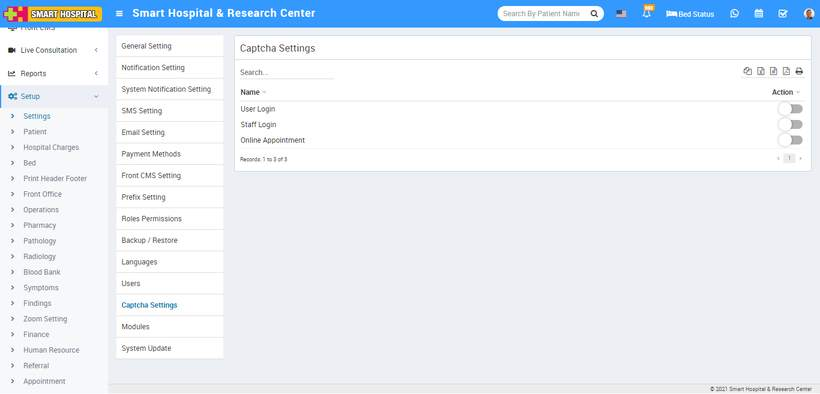

# Captcha Setting

_Mon, 01 Nov, 2021_ · [System Settings (16)](https://smart-hospital.in/category/system-settings) · vendor article: https://smart-hospital.in/article/captcha-setting

### Captcha Setting

Mon, 01 Nov, 2021

[Articles](https://smart-hospital.in/articles)[System Settings](https://smart-hospital.in/category/system-settings)

---

The term Captcha stands for ‘**Completely Automated Public Turing-test to tell Computers and Humans Apart**’. Captcha is the random code generated in the form of an image to protect the web form submission automatically. Captcha ensures that the submission of the web form is done by a human not programmatically or the response from the client side is generated by a human.  
  
Here we are using text-based captcha. Text based captcha are usually known words or random combinations of letters and digits. In order to continue, a user has to decrypt the code represented in the captcha box and enter the solution into the text box.

Here in the Smart Hospital we are providing captcha code verification for 3 events **User login**, **Staff login**, **Online Appointment**.  
  
  
  
To enable captcha go to **Setup > Settings > Captcha Setting**, from here you can enable those event for which you want to use captcha code verification.
