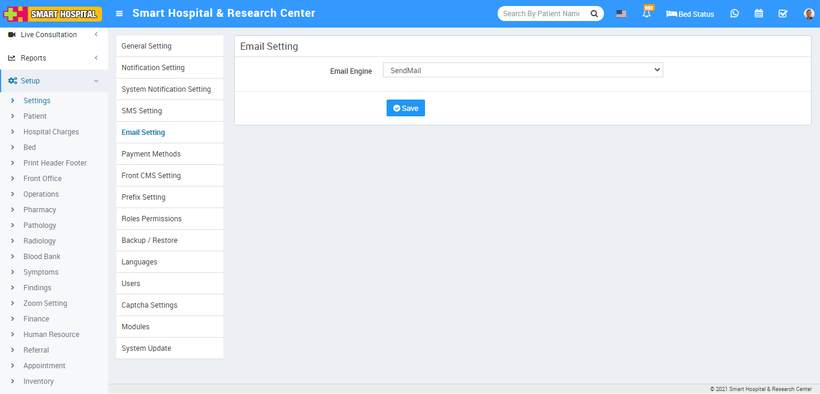
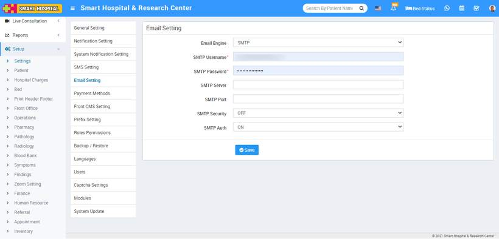

# Email Setting

_Tue, 09 Nov, 2021_ · [System Settings (16)](https://smart-hospital.in/category/system-settings) · vendor article: https://smart-hospital.in/article/email-setting

### Email Setting

Tue, 09 Nov, 2021

[Articles](https://smart-hospital.in/articles)[System Settings](https://smart-hospital.in/category/system-settings)

---

After adding student or staff if you found there is no email is sending by system then there may be email configuration issue on your server / Smart Hospital.  
  
In Smart Hospital we have used phpmailer [**https://github.com/PHPMailer/PHPMailer**](https://github.com/PHPMailer/PHPMailer)library which is used by many popular php application like WordPress, Drupal, SugarCRM, Yii, Joomla etc.  
  
By default **SendMail** is set as **Email Engine** in **Setup > Settings > Email Setting**. SendMail can only work and send emails if you cpanel hosting supports it. If SendMail not sending email then contact to your hosting provider. Since SendMail is easiest but less reliable so check email recipient account **Spam** folder because sometimes SendMail sent emails detected as spams (if using SendMail). Another and best option is to use **SMTP** as email engine. You can use **Gmail** or any other free SMTP service provider to use SMTP email engine.  
  
  
  
  
u200b  
If you are using your hosting smtp or any other provider smtp service then check their documentation for smtp settings.  
  
**Gmail SMTP configuration -**  
  
To configure gmail account first you have to create app password for SMTP service, Please check following steps to generate app password-  
  
1. Go to your Google Account.  
2. On the left navigation panel, choose Security.  
3. On the 'Signing in to Google' panel, choose App passwords. If you don’t see this option:

* 2-Step Verification is not set up for your account
* 2-Step Verification is set up for security keys only
* Your account is through work, hospital or other organization
* You’ve turned on Advanced Protection for your account

4. At the bottom, choose Select app and choose the app that you’re using.  
   5. Choose Select device and choose the device that you're using.  
   6. Choose Generate.  
   7. Follow the instructions to enter the app password. The app password is the 16-character code in the yellow bar on your device.  
   8. Choose Done.  
     
     
   After generating gmail app password for SMTP service enter credentials in Smart Hospital SMTP email configuration-

**Email Engine = SendMail/SMTP**  
**SMTP Username = your gmail email id**  
**SMTP Password = Generated App Password**  
**SMTP Server = smtp.gmail.com**  
**SMTP Port = 587**  
**SMTP Security = TLS  
SMTP Auth = ON**  
  
  
  
***Note: After configuring email setting please check you have enabled email notification settings from Setup > Settings > Notification Setting.***
