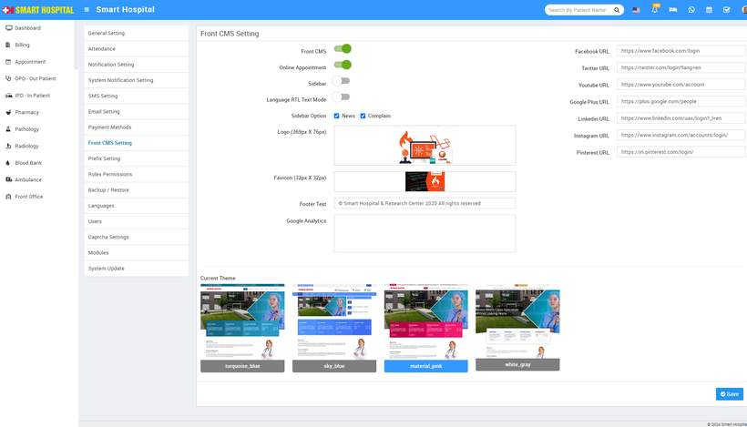

# Front CMS Setting

_Thu, 23 May, 2024_ · [System Settings (16)](https://smart-hospital.in/category/system-settings) · vendor article: https://smart-hospital.in/article/front-cms-setting

### Front CMS Setting

Thu, 23 May, 2024

[Articles](https://smart-hospital.in/articles)[System Settings](https://smart-hospital.in/category/system-settings)

---

This module is used to add menu, page, event, media manager in smart Hospital.  
  
**Front CMS module workflow-** First we will add menu and menu items, pages, banner images, event, gallery, news and media manager.  
  
First of all, configure front CMS  by **Setup > Settings > Front CMS Setting**. Here select **Enable/Disable** fields are **Front CMS, sidebar, Language RTL Text Mode, Sidebar Option, Logo (369px X 76px), Favicon (32px X 32Px), Footer Text, Google Analytics, WhatsApp URL, Facebook URL, Twitter URL, YouTube URL, Google URL, Linkedin URL, Instagram URL, Pinterest URL** and select **Current Theme** and then click on**Save** button.  
  

