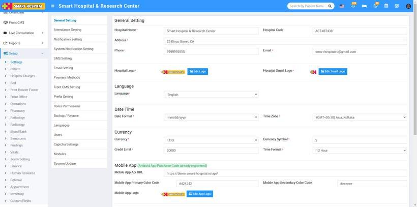

# General Setting

_Wed, 06 Nov, 2024_ · [System Settings (16)](https://smart-hospital.in/category/system-settings) · vendor article: https://smart-hospital.in/article/general-setting-1

### General Setting

Wed, 06 Nov, 2024

[Articles](https://smart-hospital.in/articles)[System Settings](https://smart-hospital.in/category/system-settings)

---

To change general setting for hospital like hospital logo, hospital name, language etc. superadmin/admin user need to login in Smart Hospital, then go to sidebar menu **Setup > Settings > General Setting** click on **Edit Hospital Logo, Edit Hospital Small Logo**and **Edit Mobile App Logo** upload logo image to update your Smart Hospital and Smart Hospital android app logo**.**Apart from logos here you can update your **Hospital Name, Hospital Code** (Is your affiliation and accreditation no)**, Address, Phone, Email, Language** (your preferred country language in which you want to run your Smart Hospital)**,** **Date Time – Date Format, Timezone, Currency – Currency**(ISO Standard 3 digit code)**, Currency Symbol, Credit Limit** **(used for IPD module balance amount credit limit)****,****Time Format (12 hours or 24 hours). Mobile App – Mobile App API URL, Mobile App Primary Color Code, Mobile App Secondary Color Code, Mobile App Logo.****Miscellaneous – Doctor Restriction Mode** (Disable/ Enable)**,** **Superadmin visibility, Patient Panel, Scan Type** **(QR Code & Barcode)** and **Current Theme** click on **Save** button to update these details.  
  
  

