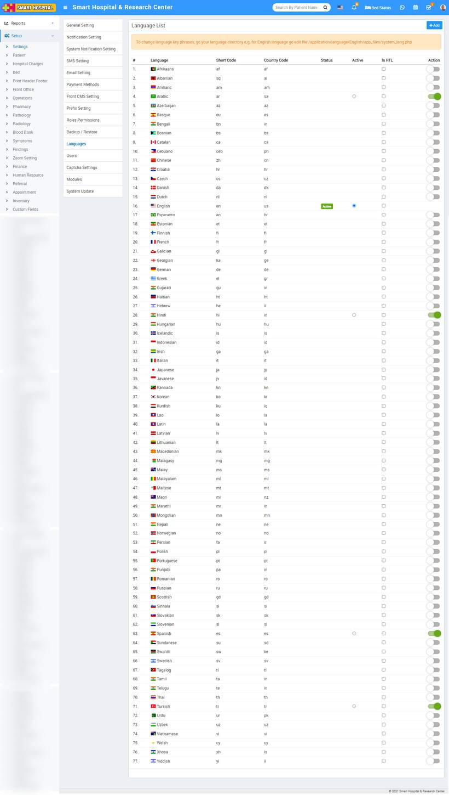

# Language Setting

_Tue, 09 Nov, 2021_ · [System Settings (16)](https://smart-hospital.in/category/system-settings) · vendor article: https://smart-hospital.in/article/language-setting

### Language Setting

Tue, 09 Nov, 2021

[Articles](https://smart-hospital.in/articles)[System Settings](https://smart-hospital.in/category/system-settings)

---

You can enable multiple languages and select your default language. To change language key phrases, go your language directory e.g. for English language go to the file /**application/language/English/app\_files/system\_lang.php** . Where as **/application/language/English/form\_validation\_lang.php** file is used for validation message text. Here we are providing 76 language in our Smart Hospital –

1. Afrikaans  
2. Albanian  
3. Amharic  
4. Arabic  
5. Azerbaijan  
6. Basque  
7. Bengali  
8. Bosnian  
9. Catalan  
10. Cebuano  
11. Chinese  
12. Czech  
13. Danish  
14. Dutch  
15. English  
16. Esperanto  
17. Estonian  
18. Finnish  
19. French  
20. Galician  
21. Georgian  
22. German  
23. Greek  
24. Gujarati  
25. Haitian (Creole)  
26. Hebrew  
27. Hindi  
28. Hungarian  
29. Icelandic  
30. Indonesian  
31. Irish  
32. Italian  
33. Japanese  
34. Javanese  
35. Kannada  
36. Korean  
37. Kurdish  
38. Lao  
39. Latin  
40. Latvian  
41. Lithuanian  
42. Macedonian  
43. Malagasy  
44. Malay  
45. Malayalam  
46. Maltese  
47. Maori  
48. Marathi  
49. Mongolian  
50. Nepali  
51. Norwegian  
52. Persian  
53. Polish  
54. Portuguese  
55. Punjabi  
56. Romanian  
57. Russian  
58. Scottish  
59. Sinhala  
60. Slovakian  
61. Slovenian  
62. Spanish  
63. Sundanese  
64. Swahili  
65. Swedish  
66. Tagalog  
67. Tamil  
68. Telugu  
69. Thai  
70. Turkish  
71. Urdu  
72. Uzbek  
73. Vietnamese  
74. Welsh  
75. Xhosa  
76. Yiddish  
  
To add language, go to **Setup > Settings > Languages** then click on **Add** button present at top right corner on the language list page, at click of this button **Add Language** modal will be open. Here enter **Language, Language Short Code, Country Code** and then click on **Save** button.  
  
  
  
  
  

To activate any language (In which you want to run Smart Hospital), click on **Action** button present in the last column.  
  
To delete language click on the **Remove** icon. 

**Note****-** You can not delete default languages.
