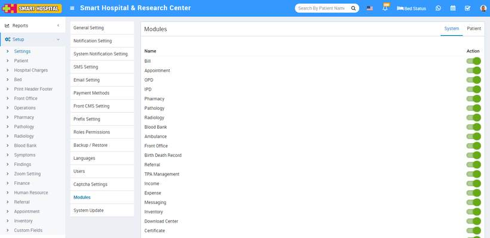

# Modules

_Mon, 01 Nov, 2021_ · [System Settings (16)](https://smart-hospital.in/category/system-settings) · vendor article: https://smart-hospital.in/article/modules

### Modules

Mon, 01 Nov, 2021

[Articles](https://smart-hospital.in/articles)[System Settings](https://smart-hospital.in/category/system-settings)

---

Smart Hospital comes with 25+ modules but there are 24 modules available to enable/disable from whole system. In Smart Hospital if you disable any module from System then disable module will be disabled for all the users of Smart Hospital that means disabled module will be disable for overall Hospital and if module disabled from Patient tab then it will be disable for Patient panel. It works over Roles Permission module so even you have given permission for module but after disabling module will be disabled from whole system. To enable/disable simply click on toggle button present in **Action** column.  
  

