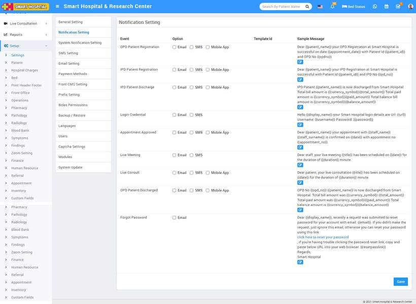
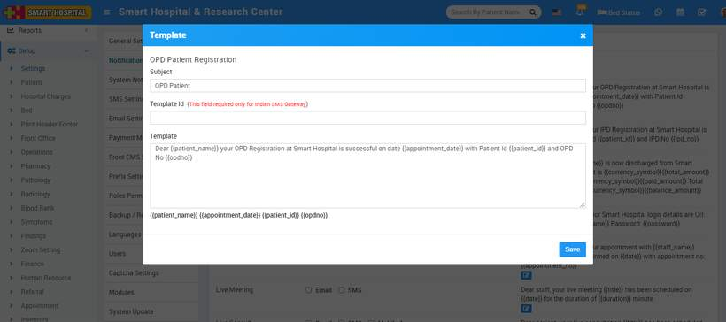

# Notification Setting

_Mon, 01 Nov, 2021_ · [System Settings (16)](https://smart-hospital.in/category/system-settings) · vendor article: https://smart-hospital.in/article/notification-setting

### Notification Setting

Mon, 01 Nov, 2021

[Articles](https://smart-hospital.in/articles)[System Settings](https://smart-hospital.in/category/system-settings)

---

To manage notification setting, go to **Setup > Settings > Notification Setting.** There are 9 events OPD Patient Registration, IPD Patient Registration, IPD Patient Discharged, Login Credential, Appointment Approved, Live Meeting, Live Consult, OPD Patient Discharged and Forget Password where automated Email / SMS are sending to concerning person's email / mobile number. To control, when email / sms notifications will be send use Notification Setting.  
  

Check the following at which event, which person receive notification

* OPD Patient Registration: OPD Patient
* IPD Patient Registration: IPD Patient
* IPD Patient Discharged: IPD Patient
* Login Credential: Patient, Staff
* Appointment Approved: Patient
* Live Meeting: Staff
* Live Consultation: Patient
* OPD Patient Discharged: Patient
* Forgot Password: Patient, Staff

  

To edit sample message click on **Edit** icon present in the sample message column, at click of this icon a modal will be open. Here enter **Subject**, **Template ID**(here Template ID is your DLT template registration ID which is used only in Indian SMS gateway), **Template** and then click on **Save** button.  
  

**Note****-**If you are using any Indian SMS gateway then your template content must be match with your DLT registered template content.
