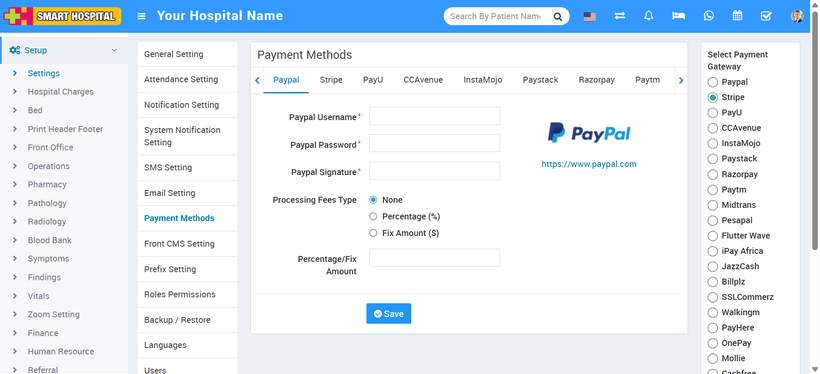

# Payment Methods

_Mon, 07 Jul, 2025_ · [System Settings (16)](https://smart-hospital.in/category/system-settings) · vendor article: https://smart-hospital.in/article/payment-methods

### Payment Methods

Mon, 07 Jul, 2025

[Articles](https://smart-hospital.in/articles)[System Settings](https://smart-hospital.in/category/system-settings)

---

For allowing patient to pay their payment online then you must have to enable any one of payment gateway, for this go to **Setup > Settings > Payment Methods** then select any payment method from top of the page then enter your payment gateway account details in required fields then click on the **Save** button.  
  
In below can also see the option to add the processing fee type. Suppose you want to charge a processing fee with the payment so you can select from two options which is displaying on below, one is a **Percentage based fee**, and the other is a **Fixed amn****ou****t fee**. When processing the payment, the processing fee amount will be displayed along with the payment amount and If you don't want to select either of the two options, you can choose the '**None**' option.

  
  
  
Here we are providing 16 payment method **Paypal**, **Stripe**, **PayU**, **CCAvenue**, **InstaMojo**, **Paystack**, **Razorpay**, **Paytm**, **Midtrans**, **Pesapal**, **Flutter** **Wave**, **IPay Africa**, **JazzCash**, **Billplz**,**SSLcommerz, Walkings.** Once you saved the record you have to **Enable** payment gateway from the right side of the page and then click on  **Save** button.

**Note****-**   
  1. You can add multiple payment gateways details but you can enable only one at a time.  
  2. Midtrans payment gateway currently supports only credit card method option in Smart Hospital.
