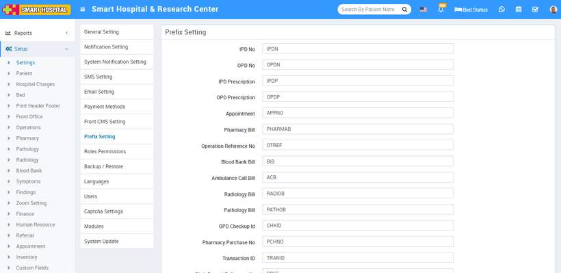

# Prefix Setting

_Tue, 09 Nov, 2021_ · [System Settings (16)](https://smart-hospital.in/category/system-settings) · vendor article: https://smart-hospital.in/article/prefix-setting

### Prefix Setting

Tue, 09 Nov, 2021

[Articles](https://smart-hospital.in/articles)[System Settings](https://smart-hospital.in/category/system-settings)

---

In Smart Hospital there is a setting available called **Prefix Setting** where you can add predefined prefix for different modules like OPD, IPD, IPD Prescription etc. For e.g For IPD No. you can set perfix as IPDN so further IPD numbers will be add as IPDN01, IPDN02 etc.  
  

