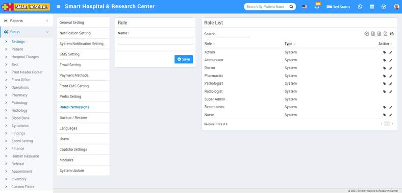
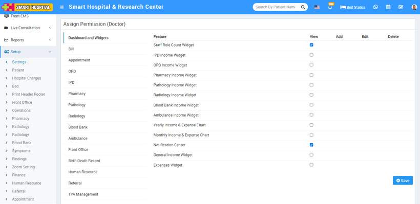
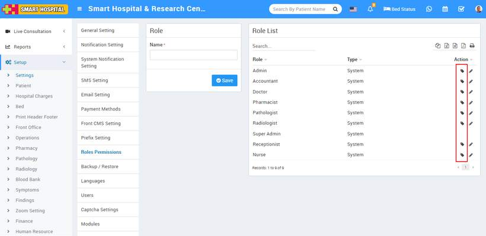
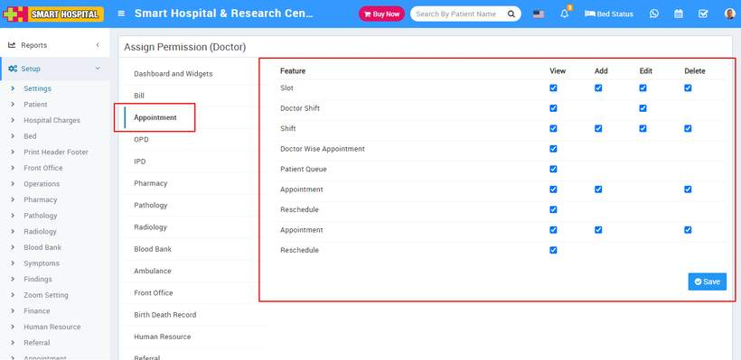

# Roles Permission

_Thu, 02 Dec, 2021_ · [System Settings (16)](https://smart-hospital.in/category/system-settings) · vendor article: https://smart-hospital.in/article/roles-permission

### Roles Permission

Thu, 02 Dec, 2021

[Articles](https://smart-hospital.in/articles)[System Settings](https://smart-hospital.in/category/system-settings)

---

A user's role determines what they can and cannot do in a site. Each role has a default set of permissions. We can assign different permission to different user according to their roles.  
  
To add roles, go to **Setup > Settings > Roles Permission** then enter role **Name** and then click on **Save** button. You can view this added record in the **Role List** on the right side of the page.  
  

To delete role click on **Delete** icon present in the role list.  
  
To assign permission click on **Assign Permission** icon present in role list, at click of this icon **Assign Permission** page will be open, Here you can assign permission for each module and then click on **Save** button.  
  
  
  
  
To edit roles and permission of the user click on assign button icon present at **Action** column.   
  
  
  
  
After click on assign permission button you will see module name at left side column so if you will click on module name then feature list will be shown related to selected module under **Feature** column. From here you can re- assign or unassigned permission of the hospital user.  
  

**Note** :- Here we have disabled edit and delete feature for superadmin to avoid any kind of accidental issues after deleting superadmin you may face issues for using Smart Hospital.
