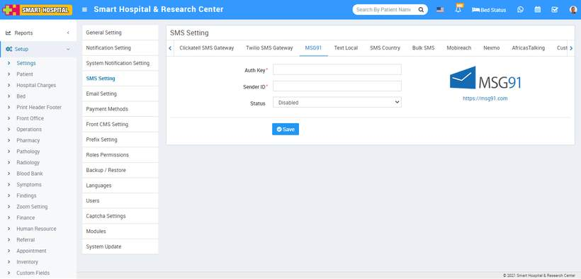
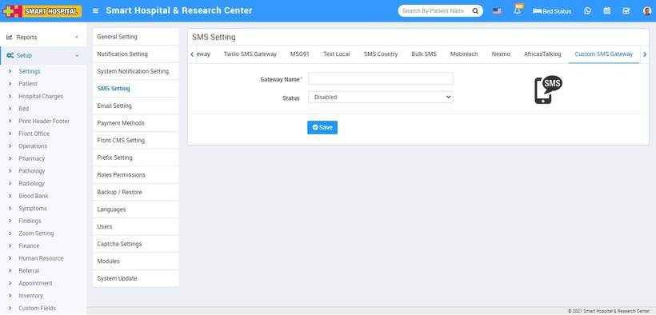

# SMS Setting

_Sat, 30 Oct, 2021_ · [System Settings (16)](https://smart-hospital.in/category/system-settings) · vendor article: https://smart-hospital.in/article/sms-setting

### SMS Setting

Sat, 30 Oct, 2021

[Articles](https://smart-hospital.in/articles)[System Settings](https://smart-hospital.in/category/system-settings)

---

To manage SMS setting, go to **Setup > Settings > SMS Setting** then select any SMS gateway from top of the page which you want to enable on your Smart Hospital then enter **Auth Key, Sender Id** and select **Status** and then click on **Save** button.  
  
  
  
Here we are providing 8 SMS Gateway namely **Clickatell SMS Gateway**, **Twilio SMS Gateway**, **MSG91**, **Text Local**, **SMS Country**, **Bulk SMS**, **Mobi Reach**, **Nexmo**, **AfricasTalking** **Custom SMS Gateway** in our Smart Hospital.

**Custom SMS Gateway-**  
  
In Smart Hospital you can integrate any http based SMS Gateway using our **Custom SMS library**. Please contact to support to get **Custom SMS Gateway** integration guide. Here enter **Gateway Name,** select **Status** (Enabled/Disabled) and then click on **Save** button.  
  
  
  
Follow same procedure to SMS gateway for **Clickatell SMS Gateway, Twilio SMS Gateway, Text Local** and **SMS Country**.
