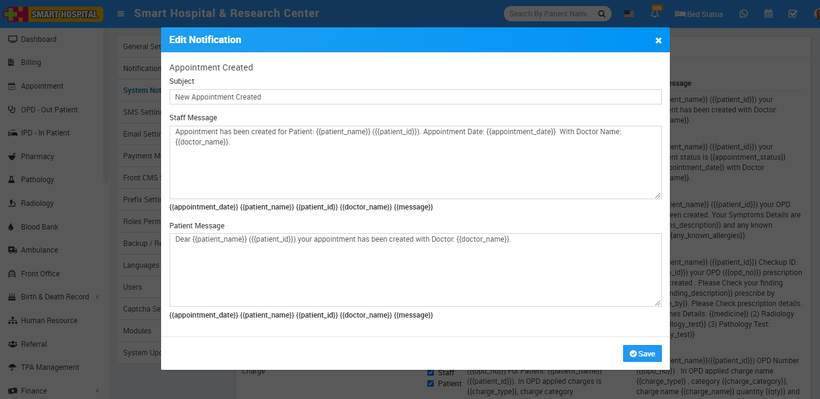

# System Notification Setting

_Mon, 01 Nov, 2021_ · [System Settings (16)](https://smart-hospital.in/category/system-settings) · vendor article: https://smart-hospital.in/article/system-notification-setting

### System Notification Setting

Mon, 01 Nov, 2021

[Articles](https://smart-hospital.in/articles)[System Settings](https://smart-hospital.in/category/system-settings)

---

To manage system notification setting, go to **Setup > Settings > System Notification Setting**.  There are 56 events  where system notification are sending to concerning user (staff or patient or both) Smart Hospital account. With the help of event option setting you can manage which notifications to send in which event to which person (staff or patient) and select the check box and then click on **Save** button.

To edit sample message click on **Edit** icon present in the sample message column, at click of this icon a modal will be open. Here enter **Subject**, **Staff message and Patient message** and then click on **Save** button.  
  

