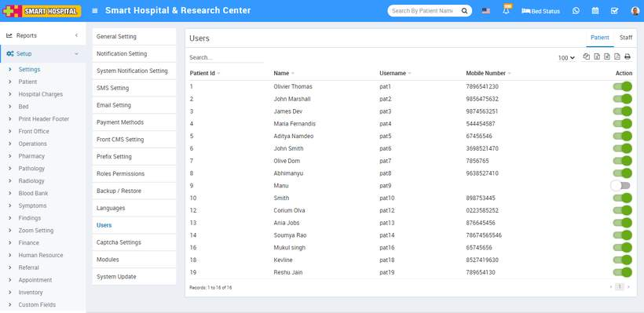

# Users

_Sat, 30 Oct, 2021_ · [System Settings (16)](https://smart-hospital.in/category/system-settings) · vendor article: https://smart-hospital.in/article/users

### Users

Sat, 30 Oct, 2021

[Articles](https://smart-hospital.in/articles)[System Settings](https://smart-hospital.in/category/system-settings)

---

All the users like Patient, Staff can be seen here and you can enable or disable them from login to system.

To enable or disable patient user. Select tab of Patients present at top right corner then click on toggle button in Action column.  
  

In same way you can enable or disable staff user.  Select tab of Staff present at top right corner then click on toggle button in Action column.
