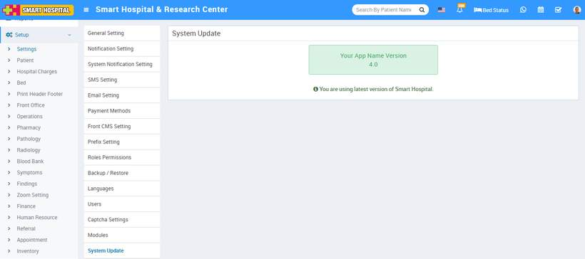

# System Update

_Sat, 30 Oct, 2021_ · [System Update(1)](https://smart-hospital.in/category/getting-started/system-update) · vendor article: https://smart-hospital.in/article/system-update

### System Update

Sat, 30 Oct, 2021

[Articles](https://smart-hospital.in/articles)[Getting Started](https://smart-hospital.in/category/getting-started)[System Update](https://smart-hospital.in/category/system-update)

---

To check Smart Hospital current version or available new version login from superadmin panel and then go to **Setup > Settings > System Update** link. Here you can see your current **Smart Hospital Version** and if here any new version available for Smart Hospital then you can update your Smart Hospital through one click auto update feature (which will show only when new version available).  
  

