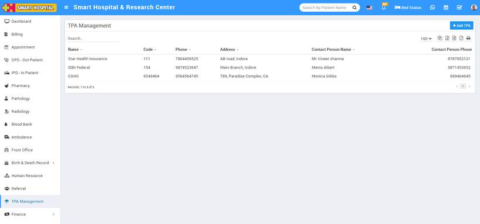
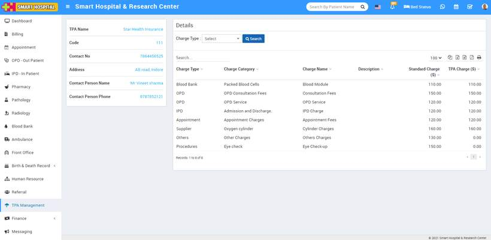

# TPA Management

_Wed, 10 Nov, 2021_ · [TPA Management (2)](https://smart-hospital.in/category/tpa-management) · vendor article: https://smart-hospital.in/article/tpa-management

### TPA Management

Wed, 10 Nov, 2021

[Articles](https://smart-hospital.in/articles)[TPA Management](https://smart-hospital.in/category/tpa-management)

---

TPA module is for managing third party administrator or Mediclaim insurance provider companies. A third-party administrator is a company that provides operational services such as claims processing and employee benefits management under contract to another company. Insurance companies and self-insured companies often outsource their claims processing to third parties. With the help of TPA patient can get lots of discount in hospital charges.  
  
To check TPA list associated with the hospital, login from superadmin, admin panel and then click on the TPA Management link present in the the left sidebar, by clicking this link you can check all TPA list.  
  

To add new TPA click on **+ Add TPA** button here enter **TPA Organization Name, Code, Contact Number, Address, Contact Person name, Contact Person Phone** then click on **Save** button.  
  

added record will be show in **TPA Management list** page.

To edit TPA record click on Edit icon and to delete TPA record click on Delete icon present at last column on mouse hover.

To see specific TPA charge details click on Organization Profile icon, for which you want to check tpa details, this will redirect you in details page, fro here you can check TPA charge details.  
  
To check all details click on the Search button this will show you all charges.  
  

Here you can edit or delete different associated charges for this TPA organization in different charge types. Associated charges should be applied first from hospital charges module.

**Add TPA charges on hospital charges -**

To add TPA charges on hospital charges, go to **Setup > Hospital Charges**, this will redirect you in **Charges Details List** page, here click on  **+Add Charges** button present at the top right corner of the page, then enter all mandatory details like **Charge Type**, **Charge Category**, **Unit Type**, **Charge Name**, **Tax Category**, **Tax Category** and **Scheduled Charges For TPA** (enter amount for different TPA) and then finally click on the **Save** button.  
  

Once TPA amount is saved, you can use it in different module. For example you have added TPA for OPD charges, now when you add any opd charge you need to selected TPA and **Charge** **Category**, **Charge** and this will automatically calculated your TPA amount. For example your OPD consultation Fees was Rs.150 and you have select CGHS TPA for which opd consultation charge was Rs.100 so your applied charge will be Rs.100 .  
  

