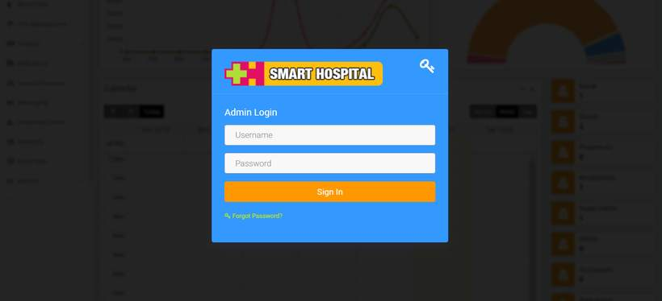
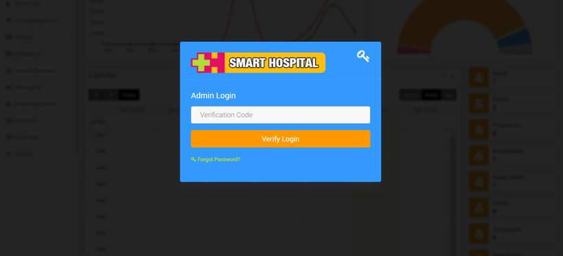
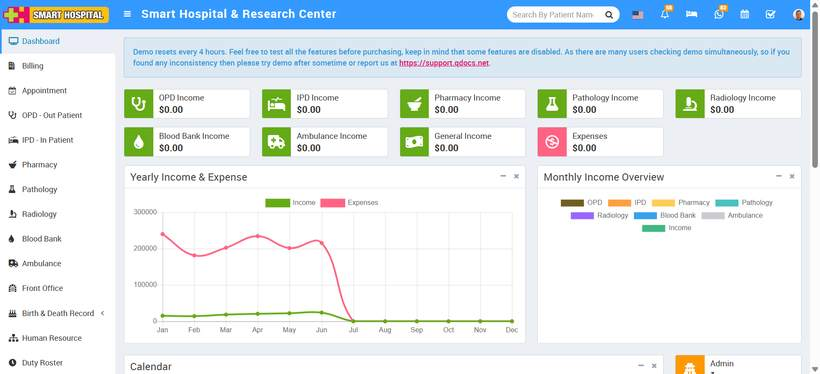

# How to check Two Factor Authentication working for superadmin in your smart Hospital?

_Sat, 16 Aug, 2025_ · [Two Factor Authentication (6)](https://smart-hospital.in/category/two-factor-authentication) · vendor article: https://smart-hospital.in/article/how-to-check-two-factor-authentication-working-for-superadmin-in-your-smart-hospital

### How to check Two Factor Authentication working for superadmin in your smart Hospital?

Sat, 16 Aug, 2025

[Articles](https://smart-hospital.in/articles)[Two Factor Authentication](https://smart-hospital.in/category/two-factor-authentication)

---

After you've enabled and configured a 2FA account in your Smart Hospital, navigate to the login page, enter your **username** and **password**, and click **Sign In**.  
  
  
  
After clicking **Sign In**, a verification window will appear on your screen, enter **the six-digit verification code** displayed in the **Google Authenticator app**, and then click **Verify & Login**.  
  
  
   
You have now successfully logged into your **Smart Hospital**.   
  

