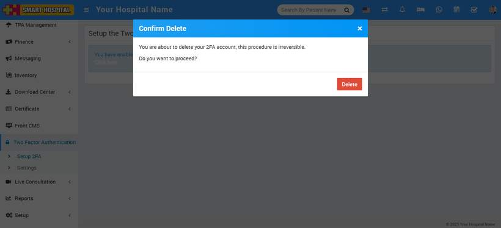

# How to delete the 2FA account for superadmin or staff?

_Sat, 16 Aug, 2025_ · [Two Factor Authentication (6)](https://smart-hospital.in/category/two-factor-authentication) · vendor article: https://smart-hospital.in/article/how-to-delete-the-2fa-account-for-superadmin-or-staff

### How to delete the 2FA account for superadmin or staff?

Sat, 16 Aug, 2025

[Articles](https://smart-hospital.in/articles)[Two Factor Authentication](https://smart-hospital.in/category/two-factor-authentication)

---

To delete the 2FA account, Super Admin or Staff, go to login in your **Smart Hospital**. After the login, go to the  **Two Factor Authentication**module, which is shown in the left side bar. Now click on **Two Factor Authentication****> Setup 2FA**. A new page will open, and a message will show, "You have enabled the 2FA method. If you want to remove your 2FA account, please "**click here".  
  
**

After **clicking here,** a delete confirmation message will appear on the screen. Now you can delete the account by clicking on the **Delete** button, which is showing in the right-bottom corner.  
  
  

