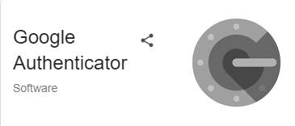

# How to Install the Google Authenticator app on a mobile device?

_Sat, 16 Aug, 2025_ · [Two Factor Authentication (6)](https://smart-hospital.in/category/two-factor-authentication) · vendor article: https://smart-hospital.in/article/how-to-install-the-google-authenticator-app-on-a-mobile-device

### How to Install the Google Authenticator app on a mobile device?

Sat, 16 Aug, 2025

[Articles](https://smart-hospital.in/articles)[Two Factor Authentication](https://smart-hospital.in/category/two-factor-authentication)

---

1. On your mobile device, go to Play Store / IOS.
2. Download the **Google Authenticator** app.
3. After downloading the app, install in your device.

  
  
  
  

4. Now open the **Google Authenticator** app and setup your first account.
5. Use the QR code or setup key in your **2FA** settings (by Google or third-party service). If you’re having trouble, go to g.co/2sv
6. Now click on **Scan a** **QR code** from your mobile.

  
  
  
  

7. Now, scan the **QR code,** which is available on your Smart Hospital **Two Factor Authentication > Setup 2FA** page**.**

  
  
  
  

8. You will receive the **six-digit verification code**, which will show up in the **Google Authenticator**
9. Now fill in the six-digit verification code below the QR code and click on "**Verify and Activate."**
10. You have successfully enabled the **2FA method** in your Smart Hospital, and a message will be shown on screen.

  

