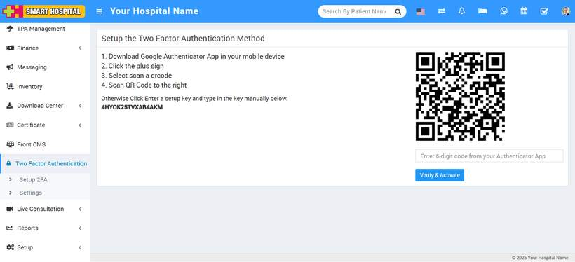
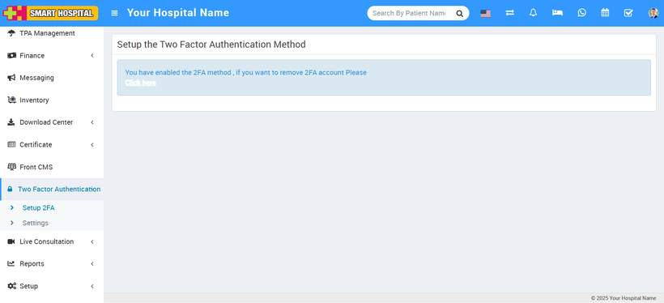

# How to manually configure the key for superadmin and staff?

_Sat, 16 Aug, 2025_ · [Two Factor Authentication (6)](https://smart-hospital.in/category/two-factor-authentication) · vendor article: https://smart-hospital.in/article/how-to-manually-configure-the-key-for-superadmin-and-staff

### How to manually configure the key for superadmin and staff?

Sat, 16 Aug, 2025

[Articles](https://smart-hospital.in/articles)[Two Factor Authentication](https://smart-hospital.in/category/two-factor-authentication)

---

To setup the key manually, Superadmin, go to the login in your **Smart Hospital**. After login the superadmin, go to the **Two Factor Authentication**module which is showing in left side bar. Now click on **Two Factor Authentication****> Setup 2FA**, now page will open, here in left below setup key will be show.  
  

Now open the Google Authenticator app on your mobile device and setup your first account page by clicking on **Enter a setup key**.  
  

After clicking on **Enter setup key**, the account details form will open, and then enter **Account name**, **Your key** and **Type of key** and click on the **Add** button. Now click on **Add Account** in your mobile device, your account has been successfully added, and you will receive the six-digit verification code. 

Now open the your Smart Hospital, go to **Two Factor Authentication****> Setup 2FA** and fill the six digit verification code which is showing in your mobile device in right below of QR code and click on **Verify & Activate.  
  
**Your 2FA account will be activated after you click the **Verify and Activate** button, and a message will appear on your screen.   
  

